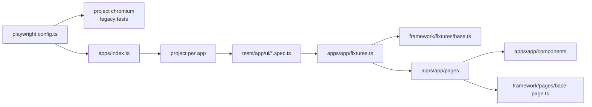

Decision: standard (2026-11-13, built by building-playwright-framework after the user chose a new framework; the previous map was confirmed by the user and is kept below as "Legacy tests")

## Test folders
- New framework: `tests/<app>/ui/` (UI specs, one scenario per file), `tests/<app>/api/` (empty so far), `tests/<app>/seed.spec.ts`. First app: `qa-practice` (22 specs + seed).
- Plans: `specs/<app>/<area>.md` (`specs/qa-practice/practice-page.md`).
- Legacy tests stay where they are (see "Legacy tests").

## Page objects and components
- `framework/pages/base-page.ts`: `BasePage` (`path`, `goto()`, `waitUntilLoaded()`).
- `apps/<app>/pages/`: one class per page. `apps/qa-practice/pages/practice-page.ts` holds one component per section and records every `alert()` message in `dialogs` (accepting it).
- `apps/<app>/components/`: section/widget classes (`LoginForm`, `SignupForm`, `ContactForm`, `FormElements`, `FunctionalArea`, `AutomationPractice`, `UiIssues`). Locators are `readonly` properties set in the constructor, next to the methods that use them.

## Fixtures and helpers
- `framework/fixtures/base.ts`: base `test` with `app` and `user` worker options, lazy per-worker login (`auth`), `storageState`, `credentials`, auto `envGuard` (skips with `<VAR> not set`). Apps with no `users` never log in.
- `apps/<app>/fixtures.ts` extends it with the app's page objects (`practicePage`).
- `framework/helpers/env.ts` (`loadDotEnv`), `framework/app-config.ts` (`resolveBaseUrl`, `resolveUser`), `framework/api/base-client.ts` (`BaseApiClient`).

## Test data
Inline per scenario (values from the plan). `apps/<app>/data/` exists for builders; empty for qa-practice.

## Config
`playwright.config.ts` loads `.env` (optional), keeps the original settings (fullyParallel, retries 1 on CI, html + json reporters, headed locally / headless on CI, trace and screenshot on failure) and has projects: `chromium` (legacy: everything under `tests/` except app folders) plus one project per app from `apps/index.ts` (`testDir: tests/<app>`, `baseURL` from the app config). `tsconfig.json` aliases `@framework/*`, `@apps/*`.

## Locators
Test id first (`getByTestId`, default `data-testid`), then role with name, then text; `#id` CSS only where an element has no test id (qa-practice inputs and buttons), with a comment in the component saying so.

## Credentials and environments
Env vars per app in `app.config.ts`, loaded from `.env` (gitignored, with `playwright/.auth/`). qa-practice: `QA_PRACTICE_URL` (default `https://qaengineerwaqas.com`), no login. Code defaults for credentials only when approved in `decisions.md`.

## Naming
Files kebab-case `<feature>-<scenario>.spec.ts`; `// spec:` and `// seed:` headers; `test.describe('<plan group title>')`; `test('<plan scenario title>')`; `// N. <plan step>` comments. Classes PascalCase, one per file.

## Running tests
`npx playwright test` (all), `npx playwright test --project=qa-practice` (one app). CI runs `npx playwright test` (all projects).

## Diagram

## Rules to follow in this repo
1. New tests go in the standard framework: `tests/<app>/ui/`, one scenario per file, from a plan in `specs/<app>/`.
2. Specs import `test`/`expect` from `@apps/<app>/fixtures` and never use `page.locator`, `page.getBy*` or `new XPage(page)`.
3. A missing locator or action goes into the page object or component, never the spec.
4. Assertions live in specs; page objects only `expect` inside `waitUntilLoaded()`.
5. After changing a page object, component, fixture or config, re-run `--project=<app>` (and the full suite for config changes).
6. qa-practice: never test the home page contact form (it posts to a real form service).

## Legacy tests (not moved yet)
Project `chromium`, folder `tests/` except app folders: `tests/swag Lab tests/` (3 specs + seed), `tests/example.spec.ts` (5 tests), `tests/seed.spec.ts` (empty stub). Rules for these files (from the confirmed map of 2026-11-13):
1. `test`/`expect` from `@playwright/test`; `{ page }` only, no page objects or fixtures.
2. `page.locator('[data-test=...]')` on Swag Labs, getByRole with names elsewhere.
3. Full URLs in `goto`; login and data inline in each test.
4. `// spec:` and `// seed:` headers, `test.describe('Swag Labs critical path')`, numbered step comments, one scenario per file.

## Notes
- The journey map's first run claimed qa-practice has no `data-testid`; it does on containers and outputs (fixed in `observations.md`).
- Form elements' Submit gives no visible feedback, so it has no test.
