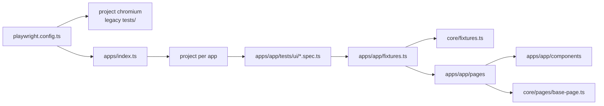

Decision: standard (2026-11-13, built by building-playwright-framework after the user chose a new framework; restructured the same day to "one folder per app + small core/" at the user's request; the previous map was confirmed by the user and is kept below as "Legacy tests")

## Test folders
- Each app holds everything in `apps/<app>/`: `tests/seed.spec.ts`, `tests/ui/` (one scenario per file), `specs/` (plans), `docs/` (knowledge base). Apps: `qapractice-com` (www.qapractice.com, 78 scenarios + seed, 2026-11-13); `thatha-zonke` (Render food-ordering demo, 12 public-surface specs + seed, 2026-11-14).
- Tests not moved yet stay in `tests/` (see "Legacy tests").

## Page objects and components
- `core/pages/base-page.ts`: `BasePage` (`path`, `goto()`, `waitUntilLoaded()`).
- `apps/<app>/pages/`: one class per page.
- `apps/<app>/components/`: section/widget classes. Locators are `readonly` properties set in the constructor, next to the methods that use them.

## Fixtures and helpers
- `core/fixtures.ts`: base `test` with the `app` worker option and an auto `envGuard` that skips with `<VAR> not set` when there is no base URL.
- `core/app.ts`: `AppConfig`, `loadDotEnv()`, `resolveBaseUrl()`, `appProject()`.
- `apps/<app>/fixtures.ts` extends the core `test` with the app's page objects (e.g. `loginPage`, `shopPage`).
- No login fixture and no API client yet: an app with a login gets a Playwright setup project (`apps/<app>/tests/auth.setup.ts`), API tests get `apps/<app>/api/` when the first one is needed.

## Test data
Inline per scenario (values from the plan). `apps/<app>/data/` is added when an app needs shared data.

## Config
`playwright.config.ts` loads `.env` (optional), keeps the original settings (fullyParallel, retries 1 on CI, html + json reporters, headed locally / headless on CI, trace and screenshot on failure) and has projects: `chromium` (legacy, `testDir: ./tests`) plus one project per app from `apps/index.ts` (`testDir: apps/<app>/tests`, `baseURL` from the app config). `tsconfig.json` aliases `@core/*`, `@apps/*`.

## Locators
Test id first (`getByTestId`, default `data-testid`), then role with name, then text; `#id` CSS only where an element has no test id, with a comment in the component saying so.

## Credentials and environments
Env vars per app in `app.config.ts`, loaded from `.env` (gitignored, with `playwright/.auth/`). Code defaults for credentials only when approved in the app's memory (`apps/<app>/memory.md`).

## Naming
Files kebab-case `<feature>-<scenario>.spec.ts`; `// spec:` and `// seed:` headers; `test.describe('<plan group title>')`; `test('<plan scenario title>')`; `// N. <plan step>` comments. Classes PascalCase, one per file.

## Running tests
`npx playwright test` (all), `npx playwright test --project=<app>` (one app). CI runs `npx playwright test` (all projects).

## Diagram

## Rules to follow in this repo
1. New tests go in the app's folder: `apps/<app>/tests/ui/`, one scenario per file, from a plan in `apps/<app>/specs/`.
2. Specs import `test`/`expect` from `@apps/<app>/fixtures` and never use `page.locator`, `page.getBy*` or `new XPage(page)`.
3. A missing locator or action goes into the page object or component, never the spec.
4. Assertions live in specs; page objects only `expect` inside `waitUntilLoaded()`.
5. Keep `core/` small: add to it only when a second app needs the same thing.
6. After changing a page object, component, fixture or config, re-run `--project=<app>` (and the full suite for config changes).

## Legacy tests (not moved yet)
Project `chromium`, folder `tests/`: `tests/swag Lab tests/` (3 specs + seed), `tests/example.spec.ts` (5 tests), `tests/seed.spec.ts` (empty stub); plan `specs/swag-labs-critical-path.md`. Rules for these files (from the confirmed map of 2026-11-13):
1. `test`/`expect` from `@playwright/test`; `{ page }` only, no page objects or fixtures.
2. `page.locator('[data-test=...]')` on Swag Labs, getByRole with names elsewhere.
3. Full URLs in `goto`; login and data inline in each test.
4. `// spec:` and `// seed:` headers, `test.describe('Swag Labs critical path')`, numbered step comments, one scenario per file.

## Notes
- Next planned: move Swag Labs into `apps/swag-labs/` (with a login setup project), then Abacus.
