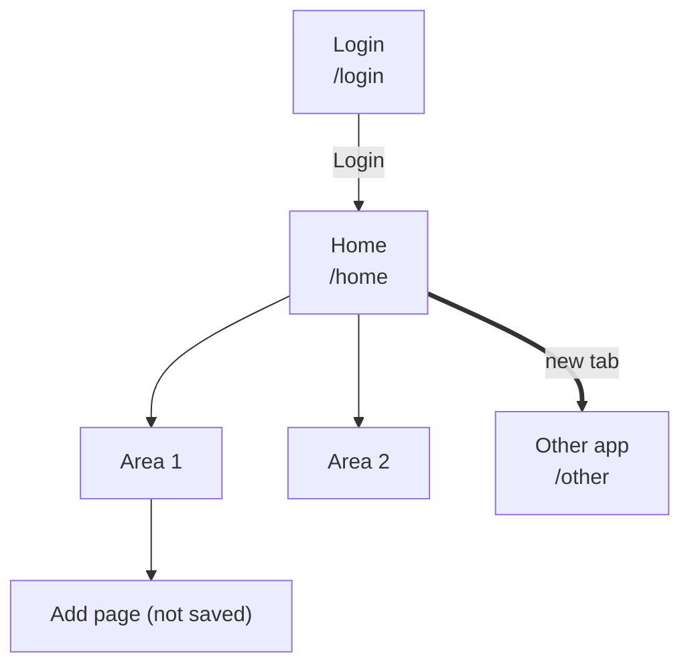

# Journey map and observations templates

## `docs/apps/<app>/journey-map.md`

````markdown
---
app: <app>
area: journey-map
title: <App> journey map
description: How <app>'s pages connect, routes, page types and exits to other apps
updated: <YYYY-MM-DD>
---

# <App>: how the site fits together

Explored <YYYY-MM-DD>, read-only. Base URL: <url>. Version (if shown): <x>.

## Overview



## How you move around

- <menus, tabs, new tabs, redirects, back buttons, logout>

## <Area or app node>

```
Page                     route              type     notes
├── Sub-page             route              list     <count>, <controls>
│   └── Detail           route              detail
└── Exit to <app>  ───►  NODE <n> (new tab)
```

(one section per area or per app node)

## Not reached

- <page> — needs a write action / needs another role / external

## Counts at a glance

| Node | Pages | Opens how |
|------|-------|-----------|
````

## `docs/apps/<app>/observations.md`

````markdown
---
app: <app>
area: observations
title: <App> observations
description: Possible bugs, quirks and inconsistencies seen while mapping <app>
updated: <YYYY-MM-DD>
---

## Possible bugs or risks
1. <what, where, how to see it>

## Quirks that matter for tests
- <slow loads, timing, locator gotchas, accessible-name oddities>

## Not checked
- <what and why>
````
