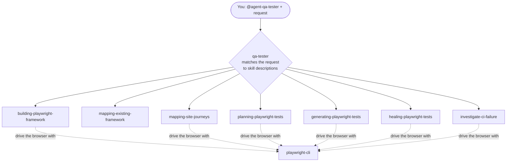

# Agentic Testing

An experiment in using Claude Code as a QA tester. One agent, `qa-tester`,
plans, writes, runs and fixes Playwright tests, and explains CI failures.
Everything it knows how to do lives in skills. The demo app under test is
[Swag Labs](https://www.saucedemo.com).

## The idea: one agent, many skills

There are two ways to set up AI agents for testing:

- **Many agents:** one agent per job (a planner, a generator, a healer...).
  Playwright's `init-agents` gives you this setup.
- **One agent, many skills:** a single generic agent with a toolbox of skills.

This repo uses the second way. The `qa-tester` agent file stays small. It
says who the tester is, how it works and what it must never do. What it can
*do* lives in skills under `.claude/skills/`. To add a capability, you add a
skill and leave the agent alone.



How it picks a skill: the agent sees only each skill's `name` and
`description` at start-up, and loads a skill's full `SKILL.md` when the
request matches. So the description does all the work. The agent has no
`skills:` list, so a new skill needs no change to the agent.

The agent also has a **memory** in `.claude/agent-memory/qa-tester/`,
committed to git. It holds the confirmed map of the test framework, failure
patterns, CI patterns and decisions. It reads the memory before each task and
updates it afterwards.

## The skills

| You want to... | Skill |
|---|---|
| Start testing a repo that has no tests | `building-playwright-framework` |
| Work in a repo that already has tests | `mapping-existing-framework` |
| Look at a website for the first time | `mapping-site-journeys` |
| Decide what to test | `planning-playwright-tests` |
| Turn a plan or steps into test code | `generating-playwright-tests` |
| Fix tests that fail on your machine | `healing-playwright-tests` |
| Find out why tests failed in CI | `investigate-ci-failure` |
| Click around a page, screenshot, find a locator | `playwright-cli` |

The rules they follow: **map first** (know the framework before touching
tests), **plan first** (no test without a plan in `specs/`), and **one
browser tool** (`playwright-cli`, not MCP, because it costs fewer tokens).

## Using it

From a Claude Code session in this repo:

```
@agent-qa-tester write a test plan for the Swag Labs inventory page
@agent-qa-tester write the test for scenario 1.3
@agent-qa-tester the checkout tests are failing, fix them
@agent-qa-tester why did CI fail on the last run?
```

Run the tests yourself:

```
npm ci
npx playwright install --with-deps
npx playwright test
```

## On GitHub

| Workflow | What it does |
|---|---|
| `playwright.yml` | Runs the tests on push and PR. If they fail, it calls the investigator. |
| `investigate-ci.yml` | Runs Claude with the `investigate-ci-failure` skill and uploads a markdown report. |
| `claude.yml` | The `@claude` assistant on issues and PRs. `@claude investigate` starts an investigation. |
| `claude-code-review.yml` | A Claude code review of a PR, run by hand. |

The skill holds the logic and the workflow is only the trigger, so the same
investigation runs on your machine and on CI.

## Repo layout

| Path | What's in it |
|---|---|
| `.claude/agents/qa-tester.md` | The agent |
| `.claude/skills/` | The skills |
| `.claude/agent-memory/qa-tester/` | The agent's memory |
| `tests/` | Playwright tests |
| `specs/` | Test plans |
| `.github/workflows/` | CI and Claude workflows |
| `docs/superpowers/` | Design specs, implementation plans and skill test logs |
| `lessons learned/` | What we learned building all this |

## Lessons learned

Notes written as we built the project, in roughly the order we learned them.

**Getting started**

- [01 Getting started](lessons%20learned/01-getting-started.md): installing Playwright and the Claude Code agents
- [02 CLI vs MCP](lessons%20learned/02-cli-vs-mcp.md): two ways for an AI to drive a browser
- [03 CLI vs MCP pricing](lessons%20learned/03-cli-vs-mcp-pricing.md): what each one costs, measured

**GitHub and CI**

- [04 GitHub and Claude setup](lessons%20learned/04-github-and-claude-setup.md): connecting the repo to GitHub Actions and Claude
- [05 claude.yml explained](lessons%20learned/05-claude-yml-explained.md): the `@claude` workflow, line by line
- [07 Public vs private repo](lessons%20learned/07-public-vs-private-repo.md): what going private changes
- [08 The CI investigator](lessons%20learned/08-ci-investigator.md): how failures get investigated on GitHub
- [13 Logging token usage](lessons%20learned/13-logging-token-usage.md): what each Claude call in CI costs

**Skills and the agent**

- [09 Skill frontmatter](lessons%20learned/09-skill-frontmatter.md): frontmatter and the format we use
- [10 Skill best practices](lessons%20learned/10-skill-claude-skills-best-practices.md): writing skills Claude can find and use
- [11 The QA tester super agent](lessons%20learned/11-qa-tester-super-agent.md): one agent, many skills, and why
- [12 Agent memory](lessons%20learned/12-agent-memory.md): how the agent remembers between calls
- [14 Test framework skills](lessons%20learned/14-skill-test-framework-skills.md): map first, then build or follow
- [15 Skill overview](lessons%20learned/15-skill-overview.md): one page on all the skills and how they connect
