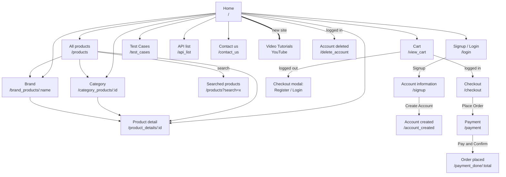

# Automation Exercise: how the site fits together

Explored 2026-11-17, read-only for the map. Base URL:
https://www.automationexercise.com. A Django demo shop (clothing, prices in
Rs.) built for automation practice. Footer: "Copyright © 2021".

## Overview



## How you move around

- Top menu (`.shop-menu`) on every page: Home, Products, Cart, Signup / Login,
  Test Cases, API Testing, Video Tutorials (YouTube), Contact us. Logged in,
  "Signup / Login" becomes Logout and Delete Account, plus "Logged in as
  <name>".
- Left sidebar on home, products, category, brand and detail pages:
  CATEGORY accordion (Women, Men, Kids) and BRANDS (8, with counts).
- "Add to cart" opens a modal ("Added!", View Cart / Continue Shopping);
  nothing navigates until View Cart.
- Footer on every page: SUBSCRIPTION email box; a scroll-up arrow
  (`#scrollUp`) appears once the page is scrolled.

## Shop

```
Home  /                         list     slider, 34 FEATURES ITEMS, RECOMMENDED ITEMS carousel
├── All products  /products     list     34 products, search box
│   └── Searched  /products?search=x     "SEARCHED PRODUCTS"
├── Category  /category_products/1..7    list     "WOMEN - DRESS PRODUCTS" etc.
├── Brand  /brand_products/<Name>        list     "BRAND - POLO PRODUCTS" etc.
└── Product detail  /product_details/1..  detail  quantity, Add to cart, WRITE YOUR REVIEW
```

## Account and checkout

```
Signup / Login  /login            form    login form + "New User Signup!" form
├── Account information  /signup  form    ENTER ACCOUNT INFORMATION + ADDRESS INFORMATION
│   └── Account created  /account_created  page   (writes)
Cart  /view_cart                  list    rows, X to remove, Proceed To Checkout
├── logged out → modal "Register / Login account to proceed on checkout."
└── Checkout  /checkout           page    delivery + billing address, order review, comment
    └── Payment  /payment         form    card fields
        └── Order placed  /payment_done/<total>   Download Invoice, Continue
Delete Account  /delete_account   page    (writes) "ACCOUNT DELETED!"
Logout  /logout  → /login
```

## Other pages

```
Test Cases  /test_cases     list   26 published test cases (collapsible)
API Testing  /api_list      list   14 published API endpoints
Contact us  /contact_us     form   GET IN TOUCH (name, email, subject, message, file)
Video Tutorials  ───►  YouTube channel (external, not explored)
```

## Not reached

- Nothing left unreached: flows behind writes (signup, checkout, payment,
  delete) were walked during planning with the user's approval (2026-11-17).

## Counts at a glance

| Node | Pages | Opens how |
|------|-------|-----------|
| Shop | home, products, search, 7 categories, 8 brands, detail | menu, sidebar |
| Account | login, signup, created, deleted | menu |
| Checkout | cart, checkout, payment, order placed | cart page |
| Other | test cases, API list, contact | menu |
| YouTube | external | menu, same tab |
