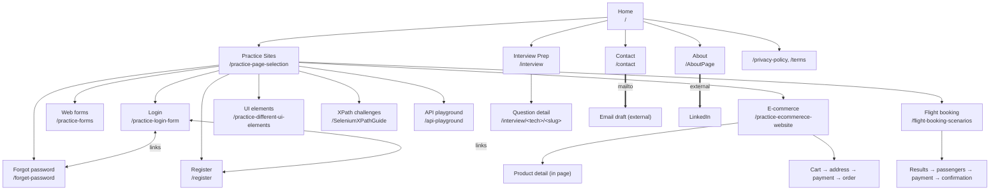

# QA Practice (qapractice.com): how the site fits together

Explored 2026-11-13, read-only. Base URL: https://www.qapractice.com. No
version shown. No real login: every practice page is public.

## Overview



## How you move around

- Top nav on every page: QA Practice (home), Practice Sites, Interview Prep,
  About, Contact. Footer: Privacy Policy, Terms.
- Practice Sites has one card per area with a "Start practising →" link.
- Each practice page (login, forms, e-commerce, flight, UI elements) has
  collapsible guide panels: "Working Automation Example" (Playwright and
  Selenium tabs), "Locator Cheat Sheet", "Test Cases & Expected Behaviors"
  (with "Download (.md)").
- E-commerce and flight booking are single-page multi-step flows (no route
  change between steps).

## Practice areas

```
Practice Sites                 /practice-page-selection        list    9 cards
├── Login                      /practice-login-form            form    email, password, remember me, Sign in
│   ├── → Forgot password      /forget-password                form    email, Continue
│   └── → Register             /register                       form    email, password, confirm, Register
├── Web forms                  /practice-forms                 form    country, title, names, DOB, DOJ, email, phone, comm. radio, Clear, Submit
├── E-commerce                 /practice-ecommerece-website    list    8 products/page, 3 pages, search, 5 categories, sort, cart
│   └── Cart → address → payment → order (in page; reached only by Add to Cart)
├── Flight booking             /flight-booking-scenarios       form    from, to, dates, passengers, class, one-way, Search
│   └── Results → passengers → payment → confirmation (in page)
├── UI elements                /practice-different-ui-elements tool    text, textarea, checkboxes, radios, dropdowns, slider, date, file, button, progress, modal, tabs, accordion, toast
├── XPath challenges           /SeleniumXPathGuide             tool    130 challenges (49 easy, 53 medium, 28 hard), search, filters
└── API playground             /api-playground                 tool    in-browser console for https://www.qapractice.com/api
```

## Other pages

```
Interview Prep                 /interview                      list    search, tech/level/status filters, sort, 12 per page, bookmarks
│   └── Question detail        /interview/<tech>/<slug>        detail
About                          /AboutPage                      detail  → LinkedIn (external), mailto
Contact                        /contact                        form    name, email, topic, message, "Open email draft" (mailto)
Privacy / Terms                /privacy-policy, /terms         detail
```

## Not reached

- E-commerce cart contents, address, payment and order confirmation: need
  Add to Cart (a write action while mapping). The site says it is all in the
  browser, so test planning may go there.
- Flight results and later steps: reached through Search, explored during
  planning.
- External sites (LinkedIn, Google ads): front door only.

## Counts at a glance

| Node | Pages | Opens how |
|------|-------|-----------|
| Site pages | home, practice sites, about, contact, privacy, terms | top nav / footer |
| Practice areas | 9 | Practice Sites cards |
| Interview library | list + one detail page per question | /interview |
| XPath challenges | 130 in one page | /SeleniumXPathGuide |
