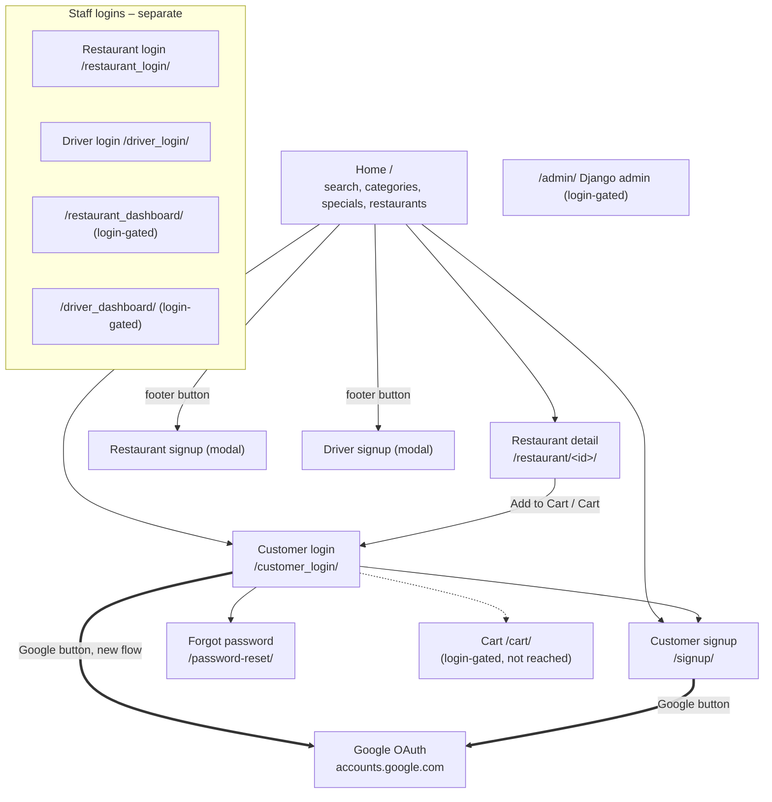

# Thatha Zonke: how the site fits together

Explored 2026-11-14, read-only. Base URL:
`https://thathazonke-rl1d.onrender.com`. A Django app (food ordering /
delivery marketplace) for local restaurants in Pretoria/Mamelodi, South
Africa. Business hours shown as 09:00–20:00 daily. No version shown.

## Overview



## How you move around

- **Top nav (home):** logo → `/`, "Restaurants" (anchor `#restaurants`),
  theme-colour toggle, "How it Works" (anchor `#customer-flow`),
  "🛒 Cart" → `/cart/`, "🔑 Login" → `/customer_login/`,
  "Sign Up" → `/signup/`. A hamburger (`☰`) holds the same links at mobile
  width.
- **Restaurant nav:** trimmed to logo + "🛒 Cart". No login/signup links.
- **Everything ordering-related is login-gated.** `/cart/` and every
  "Add to Cart" button redirect to `/customer_login/?next=…` when logged
  out. The guest never reaches the cart, checkout, order tracking or any
  dashboard.
- **Google sign-in** opens the real Google OAuth flow (external); not
  explored past its front door.
- **Push-notification banner** ("Enable / Not now") and a "DRIVER UPDATE"
  toast appear on load; both dismissable.
- **Guided tour**: "take the 30-second guided tour" steps through 5 cards
  (Set area → Browse → Pay → Track → Enjoy) in a dialog.

## Home ( / )

```
Page                     route                         type      notes
Home                     /                             landing   search + area select + GPS; category tiles;
│                                                                 specials carousel (5); "Open right now" (4);
│                                                                 "Popular Restaurants" (6); customer-flow steps
├── Category filter      /?food_type=<Type>#restaurants list     Kota, Chicken, Burgers, Pizza, Braai, Chips,
│                                                                 Drinks, Other — but does NOT filter (see obs.)
├── Search              /?search=<q> (GET)             list      area select: Any/Pretoria West/Mamelodi/
│                                                                 Centurion/Soshanguve/Soweto
└── Restaurant card ──► /restaurant/<id>/              detail
```

## Restaurant detail ( /restaurant/&lt;id&gt;/ )

```
Page                 route               type    notes
Restaurant detail    /restaurant/<id>/   detail  hero carousel, rating/ETA/area, menu with
                                                 food-type tabs, "Add to Cart" per item,
                                                 "View Cart" bar. Known ids: 2,3,4,5,6,19
                                                 (others 404). IDs are sequential/enumerable.
└── Add to Cart ──►  /customer_login/?next=/restaurant/<id>/   (login-gated)
```

## Accounts

```
Page                route              type   fields (required*)
Customer login      /customer_login/   form   username*, password*, remember; "Sign In →"
   (also /cart/ and /accounts/login/ redirect here when logged out)
Customer signup     /signup/           form   full_name*, phone_number*, email*,
                                              delivery_address*, password*, confirm_password*
Forgot password     /password-reset/   form   email*
Restaurant login    /restaurant_login/ form   username*, password*, remember
Driver login        /driver_login/     form   username*, password*
Restaurant signup   modal on /         form   restaurant_name*, full_name*, email*, phone*, address*
Driver signup       modal on /         form   full_name*, email*, phone*, vehicle*
```

## Not reached (login-gated or external)

- `/cart/`, checkout, order tracking — need a customer login (would require
  creating a real account; not done without approval).
- `/restaurant_dashboard/`, `/driver_dashboard/` — redirect to login.
- `/admin/` — Django admin login.
- Google OAuth — external.
- Restaurant/driver signup modals — open freely, but **not submitted**
  (they POST a real application).

## Counts at a glance

| Node | Pages | Opens how |
|------|-------|-----------|
| Home | 1 (+ search/category query variants) | direct |
| Restaurant detail | 6 live (ids 2,3,4,5,6,19) | card / URL |
| Account pages | 7 (2 customer, forgot-pw, 2 staff login, 2 signup modals) | nav / footer / URL |
| Login-gated | cart, checkout, dashboards, admin | not reached |
| External | Google OAuth, Facebook, TikTok | new tab |
