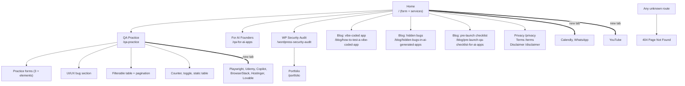

# QA Practice: how the site fits together

Explored 2026-11-13, read-only. Base URL: https://qaengineerwaqas.com (practice page: `/qa-practice`). No version shown. No login anywhere.

The site is a React single-page app (client-side routing, Radix UI components) of a freelance QA engineer. Only `/qa-practice` is a practice exercise; every other page is marketing or legal content. All practice exercises live on that one page, as sections.

## Overview



## How you move around

- Header on every page: logo (`/`), Home, For AI Founders, WP Security Audit, QA Practice, "Book a call" and "WhatsApp me" (both new tab). A menu button exists for narrow screens (not tried).
- Footer on every page: Home, QA for AI Apps, WordPress Security Audit, three blog posts, QA Practice, Privacy, Terms, Disclaimer.
- Plain `<a>` links, same tab; only external links open a new tab (`target=_blank`).
- The document title lags behind the route in the SPA.
- Unknown routes (including `/blog`) show a 404 page with a link back to `/`.

## Node 1: qaengineerwaqas.com (the site)

```
Page                          route                                         type       notes
├── Home                      /                                             landing    contact form (name, email, site, message; "Send message" not pressed), services, FAQ
├── For AI Founders           /qa-for-ai-apps                               content    9 headings, no form
├── WP Security Audit         /wordpress-security-audit                     content    $349 service page, links to /portfolio
│   └── Portfolio             /portfolio                                    content    QA Lead profile, case studies
├── Blog post 1               /blog/how-to-test-a-vibe-coded-app            article
├── Blog post 2               /blog/hidden-bugs-in-ai-generated-apps        article
├── Blog post 3               /blog/pre-launch-qa-checklist-for-ai-apps     article
├── Privacy                   /privacy                                      legal
├── Terms                     /terms                                        legal
├── Disclaimer                /disclaimer                                   legal
├── (no index)                /blog                                         404
└── QA Practice               /qa-practice                                  tool       see node 2
```

## Node 2: QA Practice page, `/qa-practice` (single page, sections top to bottom)

```
Section                          ids                                              type      notes
├── Ad space banner (static text)
├── Practice Forms
│   ├── Login Form               #login-email #login-password #login-submit       form      "Login"
│   ├── Signup Form              #signup-name/-email/-password/-confirm #signup-submit   form
│   ├── Contact Form             #contact-name/-email/-message #contact-submit    form      "Missing Validations", button "Send"
│   └── Form Elements            #select-country (Radix combobox: United States, United Kingdom, Pakistan, India), #terms-checkbox, #newsletter-checkbox, #elements-submit   form
├── UI/UX Issues
│   ├── Misaligned Elements      Button 1/2/3 (no ids)                            ui bug    intentional
│   ├── Broken Button            #broken-button "Click Me (Disabled Bug)"         ui bug    disabled
│   ├── Overlapping Text                                                          ui bug    intentional
│   └── Responsiveness Issue     fixed 500px box                                  ui bug    intentional
├── Functional Testing Area      #search-input, #filter-all/-manual/-automation/-ai, #prev-page, #next-page   list/search   10 items, 4 per page, 3 pages
├── Automation Practice
│   ├── Dynamic Counter          #counter-increment/-decrement/-reset             tool
│   ├── Toggle Element           #toggle-button (Hide/Show Element)               tool      visibility
│   └── Data Table               Tool / Type / Level, 5 rows                      table     static
├── Affiliate promos (Hostinger "Get Started", Lovable "Try Lovable Free")  ───► external, new tab
├── Recommended tools (4 "Visit" cards)                                       ───► external, new tab
└── SEO text: guides and 5 suggested automation projects (static content)
```

Functional table data: 1 Playwright Tutorial (automation), 2 Manual Testing Basics (manual), 3 Selenium Guide (automation), 4 Bug Report Writing (manual), 5 GitHub Copilot for QA (ai), 6 API Testing Intro (automation), 7 Test Case Design (manual), 8 AI Test Generation (ai), 9 CI/CD Pipeline Setup (automation), 10 Performance Testing (manual). Filters: Manual 4, Automation 4, Ai 2. Search is a case-insensitive substring ("sel" gives Selenium Guide; no match shows "No results found").

Static data table: Playwright E2E Advanced; Selenium E2E Intermediate; Cypress E2E Intermediate; JUnit Unit Beginner; Postman API Beginner.

## External exits (never opened, not explored)

Calendly (Book a call), wa.me WhatsApp, hostinger.com (affiliate), lovable.dev, playwright.dev, udemy.com, github.com/features/copilot, browserstack.com, youtube.com/@qaengineerwaqas.

## Not reached

- Result of Login, Signup, Contact, Form Elements Submit and Home "Send message": not reached (needs a write action).
- Button 1/2/3: not clicked (type=submit, outcome unknown).
- Counter "Reset": not clicked (name matches a write action).
- No pages needing login were found.
- External sites: not opened.

## Counts at a glance

| Node | Pages | Opens how |
|------|-------|-----------|
| Site | 10 content routes (/, /qa-for-ai-apps, /wordpress-security-audit, /portfolio, 3 blog, 3 legal) plus 404 | link, same tab |
| /qa-practice | 1 page: 3 forms + elements form, UI bug section, 10-row table (3 pages), counter, toggle, 5-row table | menu link |
| External | about 9 sites | new tab |
