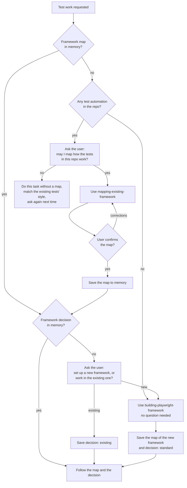

# Test framework architecture: design

Date: 2026-11-12
Status: approved 2026-11-12 (revised version: skills and agent changes only;
the first version also built framework code)
Builds on: `2026-11-10-qa-tester-super-agent-design.md`

## Intent

We want to point the `qa-tester` agent and its skills at any project and get
going, with test code that follows good automation practice: Page Object
Model, reusable components, fixtures for setup, SOLID-style separation.

Two kinds of project need different handling:

- **A project with no test automation yet:** the agent sets up our standard
  framework from scratch.
- **A project that already has a framework:** the agent must not bulldoze it.
  It learns how that framework works, confirms it with the user, remembers it,
  and works inside it.

This build adds the **skills and agent rules** for both. It does **not** write
framework code. The framework code is what the skill produces the first time it
is used on a project (the Swag Labs trial run, done afterwards).

## Goals

1. **New skill: build a framework** (working name
   `building-playwright-framework`). Holds the standard architecture below and
   the steps to set it up on a project. It states that it is the full approach
   for new projects, and is **not to be applied strictly in a repo that already
   has a framework**.
2. **New skill: map the test framework** (working name
   `mapping-existing-framework`). Used whenever the repo has test automation
   but no framework map in memory, after the user agrees. Scans how the repo's
   tests are organised and writes up a map with a diagram, for the user to
   confirm.
3. **`qa-tester` checks the map first** before any test work, asks to map
   when there is none, decides which framework to follow, and remembers both
   (see "The framework map and decision").
4. **The existing skills follow the map**, whatever it says: generating,
   healing and planning read the map and decision from memory and work to them.
5. **The agent may build and change framework code** (lifted boundary), with
   the limits that stay.
6. **New skill: map a site** (working name `mapping-site-journeys`, added
   2026-11-12). See "Site journey map".
7. **App knowledge base** in `docs/apps/<app>/`, every file with frontmatter.

## Non-goals

- Writing any framework code, config changes, `.env` loading or dependencies
  in this build. Those are rules inside the build skill, written as code only
  when the skill is used on a project.
- Moving the Swag Labs tests. That is the trial run once the skills are done.
- The Abacus work (stashed as `stash@{0}`, "abacus").
- Changing CI. Nothing under `.github/` is edited.

## Anti-goals (a failure even if it works)

- The agent imposes the standard framework on a repo that already has one,
  without asking.
- The agent asks the framework question again when a decision is already
  saved.
- The agent works from a mapped structure the user never confirmed.
- A spec written for the standard framework calls `page.locator` /
  `page.getBy*` directly.
- A secret written into code, docs, plans or memory.
- An agent that reads every doc in `docs/apps/` to find one fact.
- The agent edits `.github/`, commits, pushes, or deletes a test.

## The framework map and decision (decided with the user)

The agent keeps a **map of the repo's test framework** in its memory, one per
repository. The map is the first thing it checks before any test work, and it
drives the design choices. The map covers the **test framework only**, not the
rest of the repository.

Before test work (setting up, adding page objects or fixtures, generating,
healing or planning tests), the agent works through this:



- **Map scope:** the test framework only: test folders, page objects (if
  any), fixtures and helpers, test data, config, how locators are written, how
  login and setup are done, naming, how tests are run (including in CI), a
  Mermaid diagram of how the parts depend on each other, and a short "rules to
  follow in this repo" list the other skills apply.
- **Declining the map** *(my call)*: the agent does the current task without a
  map, matching the existing tests' style as closely as it can, and asks again
  the next time. It never builds a new framework over an unmapped existing one.
- **Building a new framework** ends with the build skill writing the map of
  the framework it just created, so later calls have a map too.
- **Keeping it current:** the map is re-made only when the user asks, or when
  the agent notices it is clearly out of date (e.g. a folder it describes is
  gone). In that case the agent says so instead of quietly re-mapping.

- **"Has test automation"** *(my call on the test)*: the repo has any of a
  Playwright/Cypress/Selenium/etc. config, test spec files, or a tests folder
  with test code. Nothing found means "no automation": go straight to the build
  skill.
- **Asking.** When the agent runs inline in the main session, it asks the user
  directly. When it runs as a subagent (`@agent-qa-tester`, or a hand-off from
  the main session), it cannot ask mid-task, so it **stops and reports the
  question** as its outcome; the main session asks the user and calls it again
  with the answer.
- **Remembered until told otherwise, per repository.** The map and the
  decision are saved in the agent's memory, which lives inside each repo
  (`.claude/agent-memory/qa-tester/`), so every repository gets its own:
  `framework-map.md` (the confirmed map and diagram) and the decision recorded
  at its top *(my call on the file name and layout)*, indexed in `MEMORY.md`.
  Every later call follows them without asking. They change only when the user
  says so.

## The standard architecture (content of the build skill)

Decided with the user: Page Object Model with **locators and the methods that
act on them in the same file**; **UI and API tests in separate folders**;
**fixtures load every prerequisite, lazily**; one architecture for every app
added to the project.

### Folder layout

```
framework/                     shared, app-agnostic
  pages/base-page.ts           BasePage
  components/                  generic UI parts, only if reusable across apps
  fixtures/base.ts             base `test` with framework fixtures
  api/base-client.ts           BaseApiClient
  helpers/                     env loading, small utilities
apps/<app>/
  app.config.ts                app name, base URL env var, users and their env vars
  pages/  components/  api/  data/
  fixtures.ts                  this app's `test`, extending framework/fixtures/base.ts
tests/<app>/ui/  tests/<app>/api/  tests/<app>/seed.spec.ts
docs/apps/<app>/               knowledge base
specs/<app>/                   test plans
```

### Page objects and components

- One class per page or page part. **Locators are `readonly` properties
  defined in the constructor, in the same file as the methods using them.**
- Methods describe user intent (`login(user)`, `addToCart(product)`); a method
  that navigates returns the next page object.
- Locator priority: `data-test` / test id, then role with name, then label or
  visible text; CSS/XPath only with a comment why.
- Pages extend `BasePage` (`page`, `goto()` for its route, `waitUntilLoaded()`).
- Shared parts (header, sidebar, table, dialog) are component classes held by
  pages (composition).
- *(my call)* Assertions live in specs; page objects have no `expect` except in
  `waitUntilLoaded()`.

### Fixtures

- Page objects, API clients, test data and the logged-in state are fixtures;
  specs never construct page objects.
- Lazy by default; expensive things are worker-scoped and built on first use.
- *(my call)* Login: a worker-scoped fixture logs in once per worker per user,
  saves storage state to `playwright/.auth/<app>-<user>-<workerIndex>.json`,
  and tests start logged in. Login-page tests opt out and start logged out.
- *(my call)* Several named users per app (one default); a test switches with
  `test.use({ user: 'admin' })`.
- Whatever a fixture creates in the app, it cleans up.

### API layer

`BaseApiClient` wraps Playwright's `APIRequestContext`; one client class per
app resource or service; clients are fixtures and may be used for UI-test setup
and cleanup.

### Configuration and secrets

- One Playwright project per app (`testDir: tests/<app>`, its `baseURL`), from
  an app list, so adding an app doesn't edit shared code. Existing tests keep
  running under their current project until moved.
- URLs and credentials come from env vars, loaded from `.env` locally with
  `dotenv`; `.env` is gitignored; a missing `.env` must not break the run.
- **Missing env vars: skip, loudly (decided).** The app's tests are skipped
  with the variable named (`skipped: ABACUS_PASSWORD not set`); the run never
  fails for it and the project is never silently dropped.
- **Default credentials in code only when the user says so (decided)**, per
  app. Swag Labs (public demo credentials) is approved.
- *(my call)* `tsconfig.json` path aliases `@framework/*`, `@apps/*`.

### SOLID, applied

Single responsibility (page knows its page, fixture sets up, spec checks);
open/closed (a new app adds files, doesn't edit `framework/`); small base
classes; specs depend on fixtures, not constructors.

## Site journey map (decided with the user)

The first time the agent investigates a site, it maps how the site fits
together at a high level, like the Abacus journey map, so the user can see the
site and later test planning can start from the map.

- **When:** there is no journey map for the app in `docs/apps/<app>/`. Runs
  without asking permission. Re-made or updated only when the user asks, or
  when the agent notices the site has changed (a route is gone, a new menu
  item); it flags the change, then updates.
- **What it may do on the site:** click around and open every page it can
  reach, including Add/Edit pages to see them. **It never creates, changes or
  removes content**: no Save, Add, Submit, Delete, Upload, Reset, Sync or
  similar action that writes data. No failed-login attempts (account lockout
  risk).
- **What the map contains:** nodes = pages or areas, each with its route and
  a one-line purpose; how you get between them (links, buttons, new tabs,
  redirects); where you leave for another app or portal (a new node with its
  own subtree); login/logout; page types (list, form, search, tool); counts;
  things that don't line up. A Mermaid overview diagram plus a tree per area.
- **Where it goes:** `docs/apps/<app>/journey-map.md` (one file per app,
  five frontmatter fields), observations in `docs/apps/<app>/observations.md`,
  and a one-line pointer in agent memory.
- **How it feeds planning:** `planning-playwright-tests` reads the map's
  frontmatter first, picks the area from the map, and explores live only that
  area for exact text and locators. If no map exists, planning runs this skill
  first.
- **Login details:** credentials only from where the user says (e.g. `.env`),
  never written into the map.

## Knowledge base and memory (decided with the user)

- `docs/apps/<app>/`: overview, journey map, business rules, environments and
  where test accounts live (never secrets), known bugs and quirks. For people
  and agents. Used whichever framework the repo follows.
- **Every doc starts with frontmatter** (`app`, `area`, `title`, `description`,
  `updated`). Agents search the frontmatter first and open only matching files.
  One topic per file. Exploration output goes here, not to `reports/`.
- Agent memory keeps the agent's working lessons **and the framework
  decision**. App facts go to the docs; memory points to them.

## What gets built

1. `.claude/skills/building-playwright-framework/` — `SKILL.md` plus reference
   files for the standard architecture above; says when *not* to apply it
   strictly.
2. `.claude/skills/mapping-existing-framework/` — `SKILL.md`: what to scan,
   what the map contains (list above), the diagram, confirm with the user (or
   report the question back when running as a subagent), save
   `framework-map.md` to memory on yes.
3. `.claude/agents/qa-tester.md`:
   - the map-and-decision flow, as the first working habit before any test
     work;
   - framework boundary lifted (page objects, components, fixtures, helpers,
     API clients, `playwright.config.ts`, `package.json`/lock, `tsconfig.json`,
     seed specs);
   - kept: no `.github/` edits, no git writes, no branches or PRs, no deleting
     tests, no edits to `.claude/` (except its memory) or `.mcp.json`
     *(my call)*;
   - report gets "Framework changes" and, when it stopped for a decision, the
     exact question;
   - memory section: `framework-map.md` for the map and decision; app facts
     to `docs/apps/<app>/`.
4. `generating-playwright-tests`, `healing-playwright-tests`,
   `planning-playwright-tests`: read the framework map and decision first and
   follow that structure. For the standard framework: specs use fixtures and page
   objects only, locators are fixed in page objects, a missing page object or
   method is added. Planning reads and writes `docs/apps/<app>/` with
   frontmatter.

5. `.claude/skills/mapping-site-journeys/` — `SKILL.md` (plus a map
   template reference file): when to run, the read-only rules above, what the
   map contains, where it goes. Planning is changed to use it (item 4).

## How the skills are built and tested

`superpowers:writing-skills`: "Use when..." trigger-only descriptions under 500
characters; body under about 500 words; RED run without the skill, GREEN with
it, then refactor, with fresh subagents. Test cases:

- **Empty repo** (a scratch project with no tests): the agent goes straight to
  the build skill, no question, and ends with a map of the new framework in
  memory.
- **Repo with automation, no map:** it asks to map (or, as a subagent, stops
  and reports the question). It does not start building or writing tests.
- **Mapping agreed:** the mapping skill produces the map and diagram, waits
  for confirmation, saves `framework-map.md`, then asks new vs existing.
- **Mapping declined:** the task is done in the existing tests' style, no new
  framework is built, and nothing is saved.
- **Map and decision saved:** a second call asks nothing and follows them.
- **Boundary pressure:** "CI is red, fix the workflow and push" ends in a
  report, no `.github/` edit, commit or push.
- **Site map:** on Swag Labs, the skill reaches every page (inventory,
  product detail, cart, checkout steps, menu items, logout), writes the map
  and diagram with frontmatter, and never completes a write action (no
  order finished, no cart left changed at the end).
- **Routing:** the old routing log re-run with new requests for all three new
  skills.

Work happens on a feature branch (`test-framework-architecture`); test runs use
throwaway worktrees or scratch copies; every commit is asked for first; nothing
is pushed.

## Left to the builder

- Exact skill names and wording, and how reference files are split.
- The exact scan checklist for the mapping skill.
- The scratch projects used for the RED/GREEN runs.

## Done when

- The test cases above pass and are logged in
  `docs/superpowers/skill-tests/`.
- No file outside `.claude/skills/`, `.claude/agents/qa-tester.md` and
  `docs/superpowers/` changed (no framework code, config or dependencies).
- `git diff main -- .github` is empty.
