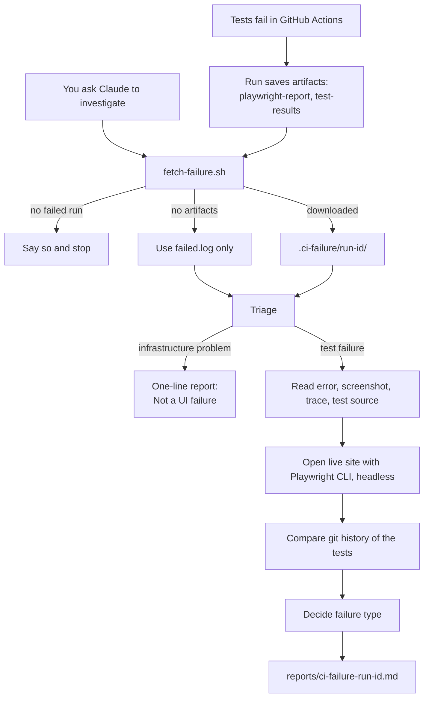

# Investigator Skill

A Claude Code skill that explains why the Playwright tests failed in GitHub
Actions. It finds the failed run, downloads what the run saved, checks the
failure against the live site with Playwright CLI, and writes a markdown report.

Design: `docs/superpowers/specs/2026-11-05-ci-failure-investigator-design.md`
Plan: `docs/superpowers/plans/2026-11-05-ci-failure-investigator.md`

> **Status (2026-11-05):** the skill works locally. The GitHub side (`@claude`
> running the skill) is written but **not tested yet**, because `claude.yml`
> runs from `main` and these changes are not on `main`. See "Not verified yet".

---

## What we are doing

When a test fails in CI, finding out why takes several manual steps: open the
run, download the report, read the error, then open the site to compare.

The skill does those steps and writes one report that says:

- which test failed,
- **why**, in one of these types:
  - **UI mismatch**: the page does not match what the test expects.
  - **Test is wrong**: "the test does X but the UI does Y".
  - **Flaky**: failed once, passed on retry.
  - **Not a UI failure**: install error, network problem, and so on.
- the evidence behind each claim.

Scope for now: UI failures only. The skill only reads and reports. It never
changes code and never opens a PR.

---

## How we are doing it

### The pieces

| Piece | File | Job |
|---|---|---|
| Richer artifacts | `playwright.config.ts`, `playwright.yml` | A failed run now saves screenshots, traces and `results.json`, not only the HTML report |
| Fetch script | `.claude/skills/investigate-ci-failure/scripts/fetch-failure.sh` | Finds the failed run and downloads its artifacts and log |
| Script tests | `.../scripts/fetch-failure.test.sh` | Checks the script against this repo's real run history |
| The skill | `.claude/skills/investigate-ci-failure/SKILL.md` | Tells Claude how to investigate and what the report looks like |
| GitHub hook-up | `.github/workflows/claude.yml` | Lets `@claude` run the skill and uploads the report |

The script does the predictable part (finding and downloading), so local and
GitHub runs behave the same. Claude does the judgment part (reading, comparing,
explaining).

### The flow



### Which run does it look at?

- **Default:** the latest failed run on `main`. If newer runs passed, it looks
  back to find the failure. If `main` has never failed, it says so and stops.
- **A branch you name:** the latest failed run on that branch.
- **A run ID you give:** that run, from any branch. A run ID wins over a branch.

### Where things land

| What | Where | Committed? |
|---|---|---|
| Downloaded artifacts and failed log | `.ci-failure/<run-id>/` | No (git-ignored) |
| The report | `reports/ci-failure-<run-id>.md` | No (git-ignored) |
| On GitHub, the report | workflow artifact `ci-failure-report` | Uploaded, not committed |

### The report

Every report has these headings in this order: Summary, Failure type, Failing
tests, Test vs UI, Flaky tests, Live site check, Evidence, Run.

Wording rule: the report says "mismatch". It only says "the UI changed" when a
passing run or the test history supports it, because we do not control the site
under test.

---

## How to trigger the skill

### 1. Make a failure to investigate

The skill needs a failed run. Either wait for a real one, or start the tests by
hand:

- **Browser:** Actions tab → "Playwright Tests" → **Run workflow**.
- **Terminal:** `gh workflow run "Playwright Tests" --ref main`

(The manual trigger is `workflow_dispatch` in `playwright.yml`. It appears once
that change is on `main`.)

### 2. Run the skill locally

In Claude Code, from this project:

```
/investigate-ci-failure
```

Variations:

```
/investigate-ci-failure 41894900615          # a specific run ID
/investigate-ci-failure look on branch my-branch   # a specific branch
```

Needs `gh` logged in (`gh auth status`) and Playwright CLI installed.
The report is saved to `reports/ci-failure-<run-id>.md`.

### 3. Run the skill from GitHub

Write a comment or issue that mentions `@claude`, for example:

```
@claude investigate the latest CI failure
```

`claude.yml` starts, checks out the repo (which includes the skill), and Claude
runs it. The full report is uploaded as the `ci-failure-report` artifact.

The skill never starts on its own when a test fails. It runs only when asked.

### Checking the script directly

```
bash .claude/skills/investigate-ci-failure/scripts/fetch-failure.sh            # latest failure on main
bash .claude/skills/investigate-ci-failure/scripts/fetch-failure.sh --branch X # latest failure on branch X
bash .claude/skills/investigate-ci-failure/scripts/fetch-failure.sh 12345      # a specific run
bash .claude/skills/investigate-ci-failure/scripts/fetch-failure.test.sh       # run its tests
```

Exit codes: `0` downloaded, `3` no failed run found, `4` run found but no
artifacts.

---

## Not verified yet

- **`@claude` running the skill on GitHub.** Written, not tested. The open
  question is whether the Claude action finds a project skill. The plan's
  Task 4 tests this on the real repo once the changes are on `main`.
- **Older runs.** Runs before 2026-11-05 have no `results.json`, screenshots or
  traces. The skill falls back to the failed log and the HTML report and says
  what evidence was missing.

## Lessons learned

- **Put the predictable work in a script.** Finding a run and downloading its
  files is the same every time, so it lives in a tested script. The skill is
  left to judge and explain.
- **Test the script on real history.** The first test run caught a real bug:
  `gh run download` refuses to overwrite files, so running the script twice on
  the same run failed.
- **A report needs a fixed shape.** The same eight headings every time make
  reports easy to compare and easy to check.
- **A new skill is not available in the session that created it.** It showed up
  later in the session, but not at first. Test in a fresh session.
- **`--reporter` on the command line replaces the config's reporters.** Using
  `--reporter=line` hid the new `results.json` until we dropped the flag.
