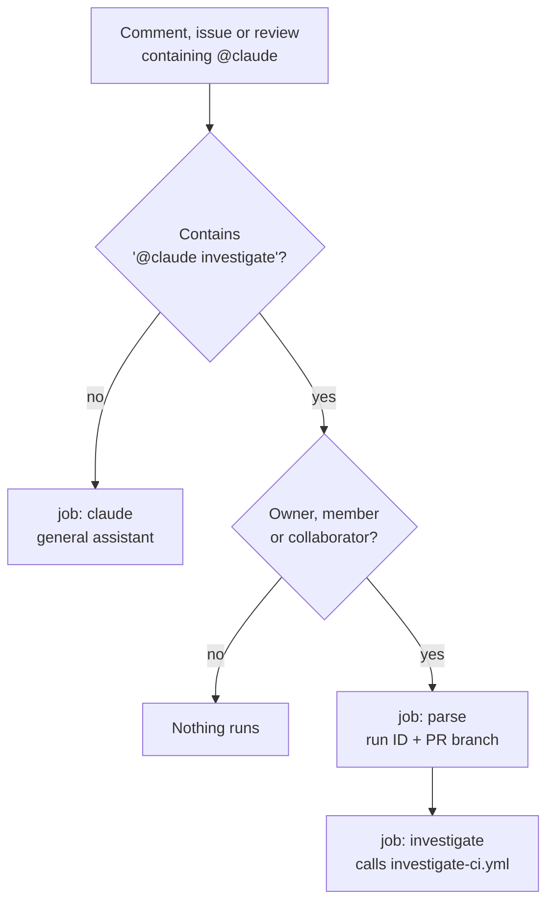

# claude.yml Explained

The workflow file `.github/workflows/claude.yml` in two parts:

1. **The default file:** what `/install-github-app` adds, explained line by
   line.
2. **Our version:** what we changed, and why.

What it does in one line: when someone writes `@claude` in an issue or PR,
this workflow starts Claude on a GitHub machine and Claude does what was asked.

---

## Part 1. The default file

As it was installed (PR #1, before any of our edits). The comments below are
added here to explain each part. They are not in the real file.

```yaml
name: Claude Code                 # Name shown in the Actions tab

on:                               # Events that START this workflow
  issue_comment:                  # A comment on an issue or on a PR conversation
    types: [created]              #   only when the comment is new (not edited/deleted)
  pull_request_review_comment:    # A comment on a specific line of a PR's code
    types: [created]              #   only when new
  issues:                         # An issue itself
    types: [opened, assigned]     #   when it is opened or assigned to someone
  pull_request_review:            # A full PR review (Approve / Request changes / Comment)
    types: [submitted]            #   only when submitted

jobs:                             # Work to do. This file has one job
  claude:                         # Job name (our choice)
    if: |                         # Run the job ONLY if one of these is true (else it is skipped)
      (github.event_name == 'issue_comment' && contains(github.event.comment.body, '@claude')) ||
      #  ^ issue/PR comment AND the comment text contains @claude
      (github.event_name == 'pull_request_review_comment' && contains(github.event.comment.body, '@claude')) ||
      #  ^ line comment on a PR AND it contains @claude
      (github.event_name == 'pull_request_review' && contains(github.event.review.body, '@claude')) ||
      #  ^ PR review AND the review text contains @claude
      (github.event_name == 'issues' && (contains(github.event.issue.body, '@claude') || contains(github.event.issue.title, '@claude')))
      #  ^ new issue AND @claude is in its title or body
    runs-on: ubuntu-latest        # The machine: a fresh Ubuntu VM, deleted after the job
    permissions:                  # What the job's built-in GitHub token may do
      contents: read              #   read the repo's files
      pull-requests: read         #   read PRs
      issues: read                #   read issues
      id-token: write             #   let the job prove its identity (used by the action to sign in)
      actions: read # Required for Claude to read CI results on PRs   #   read workflow runs and logs
    steps:                        # The job's steps, run in order
      - name: Checkout repository # Step label shown in the log
        uses: actions/checkout@v4 #   ready-made action: copies the repo onto the VM
        with:                     #   its settings:
          fetch-depth: 1          #     only the latest commit (fast, no full history)

      - name: Run Claude Code     # Step label
        id: claude                #   an ID, so later steps could read this step's outputs
        uses: anthropics/claude-code-action@v1   # The Claude action; @v1 = the v1 line of releases
        with:                     #   its settings:
          claude_code_oauth_token: ${{ secrets.CLAUDE_CODE_OAUTH_TOKEN }}
          #  ^ how Claude signs in. Read from a repo secret that /install-github-app
          #    saved. ${{ ... }} is how workflows read values; secrets are hidden in logs.

          # This is an optional setting that allows Claude to read CI results on PRs
          additional_permissions: | #   extra access for the action itself (block of text)
            actions: read           #   same permission as above: read CI runs

          # Optional: Give a custom prompt to Claude. If this is not specified, Claude will perform the instructions specified in the comment that tagged it.
          # prompt: '...'           #   commented out. No prompt = "interactive mode": Claude does
          #                         #   what the @claude comment says. With a prompt it would run
          #                         #   on its own, with no mention needed.

          # Optional: Add claude_args to customize behavior and configuration
          # claude_args: '...'      #   commented out. Where limits and allowed tools go,
          #                         #   e.g. --max-turns, --allowedTools
```

### Things to notice

- **Many runs start, few do work.** Every new comment or issue starts the
  workflow, and the `if:` then skips it unless `@claude` appears. Skipped runs
  in the Actions tab are normal.
- **No prompt means interactive mode.** The action decides its mode from the
  inputs: no `prompt` means it waits for `@claude`; a `prompt` means it runs
  right away.
- **No limits by default.** The installed file has no turn limit, no job
  timeout and no tool list. See the "Lessons learned" section in
  [04-github-and-claude-setup.md](04-github-and-claude-setup.md).
- **Read-only token.** All four permissions are `read` except `id-token`. Claude
  can look at things but the job's own token cannot write to the repo.

---

## Part 2. Our version

The triggers, permissions, checkout and Claude step are the same as the default.
We changed the following.

### Changes to the `claude` job (the general `@claude` assistant)

| Change | Why |
|---|---|
| `&& !contains(..., '@claude investigate')` added to every condition in `if:` | A comment that says `@claude investigate` belongs to the CI investigator, not the general assistant. Without this, both would start. |
| `env:` with `GH_TOKEN` and `GH_REPO` on the Claude step | So Claude can use the `gh` command against this repo. |
| `claude_args:` with `--max-turns 30` | Caps the length (and so the cost) of a run. |
| `claude_args:` with `--allowedTools "mcp__github_inline_comment__create_inline_comment"` | Allows only posting inline PR comments as an extra tool. |
| A final step "Log Claude token usage" | Prints the input, output and cache tokens of each call to the log and job summary. It always runs, and a failure there never fails the job. See [13-logging-token-usage.md](13-logging-token-usage.md). |

### Two new jobs for `@claude investigate`

| Job | What it does |
|---|---|
| `parse` | Starts only when the author is the owner, a member or a collaborator, because an investigation costs Claude usage. Reads the optional run ID from the comment (`@claude investigate 12345` or `@claude investigate run 12345`) and, on a PR, the PR's branch. |
| `investigate` | Runs after `parse` and calls the reusable workflow `investigate-ci.yml`, passing the run ID and branch, with `same_run: false` (the evidence comes from an earlier run, not this one). |



### What is no longer in this file

An earlier version of this file also installed Node, the dependencies,
Chromium and the Playwright CLI, and uploaded `reports/` as the
`ci-failure-report` artifact. That work now lives in `investigate-ci.yml`, which
is shared by this file and by `playwright.yml`. See
[08-ci-investigator.md](08-ci-investigator.md) for the full picture.
