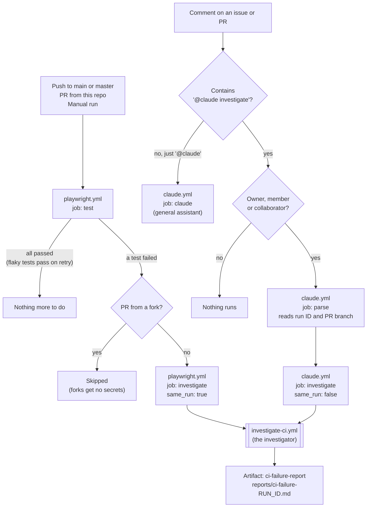
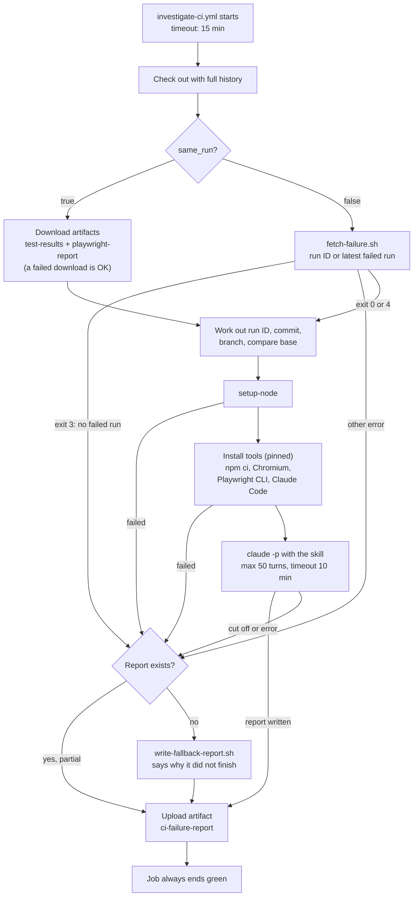
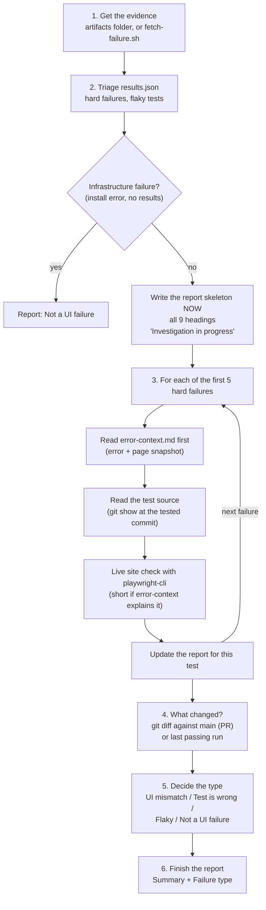

# The CI Investigator: How It Works on GitHub

When the Playwright tests fail on GitHub, Claude investigates the failure and
leaves a markdown report you can download from the run page. You can also ask
for an investigation by commenting `@claude investigate`.

This describes the `ci-investigator-auto-run` branch (PR #9). Until that is
merged, `main` still has the older, comment-only version.

## The pieces

| File | Role |
|---|---|
| `.claude/skills/investigate-ci-failure/SKILL.md` | **The skill.** All the investigation logic: what to read, how to decide the failure type, the report format. The same skill runs locally and on GitHub. |
| `.claude/skills/investigate-ci-failure/scripts/fetch-failure.sh` | Finds a failed run and downloads its artifacts and failed log. Used locally and by the comment path. |
| `.claude/skills/investigate-ci-failure/scripts/write-fallback-report.sh` | Writes a short "did not finish" report if Claude left none. |
| `.github/workflows/investigate-ci.yml` | **The investigator job.** A reusable workflow (`on: workflow_call`) that gets the evidence, runs Claude with the skill, and uploads the report. |
| `.github/workflows/playwright.yml` | Runs the tests. Its `investigate` job calls the investigator when the tests fail. |
| `.github/workflows/claude.yml` | The `@claude` assistant. Its `parse` + `investigate` jobs call the investigator on `@claude investigate`. |

The key idea: **the skill is the logic and the workflow is the trigger.** The
skill decides what to check and what the report says. The workflows only decide
when to run it, with what evidence and with what limits.

## The big picture



**There are two ways in, but only one investigator.** The automatic path and
the comment path both call the same `investigate-ci.yml`. The only difference
is where the evidence comes from:

| | Automatic path | Comment path |
|---|---|---|
| Started by | A failed test job | `@claude investigate [run <id>]` |
| `same_run` | `true` | `false` |
| Evidence | Downloaded from **this** run's artifacts | Downloaded by `fetch-failure.sh` from **another** run |
| Which run | The one that just failed | The run ID in the comment, or the latest failed run (on the PR's branch for a PR comment, otherwise `main`) |
| Report shows up on | The failed Playwright run | The `Claude Code` run started by the comment |

## Inside the investigator



**Why it's built like this:**

- **A report always exists.** No report would be the worst outcome, so there
  are three layers of protection:
  1. The skill writes the report early and fills it in as it goes.
  2. If the report is still missing, the fallback step writes one that says why.
  3. Both the fallback and the upload run with `always()`.
- **The Claude step times out before the job does.** The step stops at 10
  minutes and the job at 15, so the fallback and the upload always get time to
  run.
- **It never turns red.** Setup and Claude steps use `continue-on-error`, so a
  problem in the investigator never shows up as a second red check next to the
  real test failure.
- **The working tree stays on the workflow's own commit,** so the skill and the
  scripts are always there. Test files from the tested commit are read with
  `git show <sha>:<path>`.

**The fallback report says why there's no full report.** Its `## Summary`
gives one of these reasons:

| Reason in the report | What happened |
|---|---|
| `No failed run found` | Comment path: there was no failed run to investigate |
| `the evidence could not be downloaded (fetch-failure.sh exit N)` | The fetch script failed |
| `tool install failed: setup-node ...` | Node could not be set up |
| `tool install failed (npm ci, Chromium, Playwright CLI X or Claude Code Y) ...` | One of the installs failed. Check the "Install tools" step log |
| `the Claude step ended with outcome 'failure' ...` | Claude hit the turn limit or the timeout, or errored |
| `Claude finished but wrote no report` | Claude ran but didn't save the file |

## Inside the skill



**The report.** It is saved as `reports/ci-failure-<run-id>.md`, with these
headings in this order every time:

1. `## Summary`
2. `## Failure type`
3. `## Failing tests`
4. `## Not investigated` (hard failures beyond the first 5)
5. `## Test vs UI` ("the test does X but the UI does Y")
6. `## Flaky tests` (listed, never investigated)
7. `## Live site check` (`Reached`, `Unreachable` or `Differs from screenshots`)
8. `## Evidence` (every claim points to something seen)
9. `## Run` (run ID, commit, branch)

**Why `error-context.md` comes first.** Playwright writes it into each failed
test's folder on every failure, with no config needed. It holds the error and a
text snapshot of the page at the moment of failure. That's often enough to
explain the failure, and it costs fewer turns than a screenshot or a browser
session.

## How to use it

**Automatically:** do nothing. When a test fails, open the failed run:

- **Actions → Playwright Tests → the run → Artifacts → `ci-failure-report`**
- or download it from the terminal:

```bash
gh run download <run-id> --name ci-failure-report
```

**On request:** comment on an issue or PR, exactly like this:

```
@claude investigate
@claude investigate 42265467750
@claude investigate run 42265467750
```

The report is an artifact on the **Claude Code** run that the comment started.

**Locally:**

```
/investigate-ci-failure
/investigate-ci-failure 42265467750
/investigate-ci-failure .ci-failure/42265467750, treat the site as unreachable
```

## Limits and safety

| Limit | Value | Where |
|---|---|---|
| Hard failures investigated | 5 (the rest go under `## Not investigated`) | prompt + `SKILL.md` |
| Claude turns | 50 | `--max-turns` in `investigate-ci.yml` |
| Claude step time | 10 min | `timeout-minutes` on the Claude step |
| Job time | 15 min | `timeout-minutes` on the job |
| Tool versions | Claude Code 2.1.319, Playwright CLI 0.1.23 | `env` in `investigate-ci.yml` |
| Who can trigger by comment | Owner, member, collaborator | `parse` job `if:` in `claude.yml` |
| Fork PRs | Skipped | `investigate` job `if:` in `playwright.yml` |
| Token permissions | `contents: read`, `actions: read` | the investigator job |
| Claude's tools | `gh run`, `playwright-cli`, `git log/diff/show`, Read, Write, Edit, Glob, Grep | `--allowedTools` |

One investigation costs about **$0.40–0.65** in list-price terms on Opus
([03-cli-vs-mcp-pricing.md](03-cli-vs-mcp-pricing.md)). On CI it counts
against the Claude plan's usage limits, through `CLAUDE_CODE_OAUTH_TOKEN`.

## Lessons learned

1. **Keep the logic in a skill and the trigger in a workflow.** One skill, two
   callers, and the same behaviour locally. That's the common industry pattern:
   investigation runs automatically, fixes need a human.
2. **`claude-code-action` doesn't run on `push`.** It throws
   `Unsupported event type`. Inside a reusable workflow, `github.event_name`
   is the *caller's* event, so a failed push to `main` could never be
   investigated. A fresh reviewer caught this. We use the Claude Code CLI
   (`claude -p`) instead, which works on any event.
3. **The CLI does no permission check of its own.** `claude-code-action`
   checks that the commenter has write access. A raw `claude -p` step doesn't,
   so the comment path needs its own `author_association` check.
4. **Comment-triggered workflows always run from `main`.** A change to
   `claude.yml` on a branch can't be tested by commenting until it's merged.
   Before the merge, an `@claude investigate ...` comment ran the *old* job,
   which just answered in a comment and never ran the skill, so there was no
   report.
5. **The trigger phrase must be exact.** GitHub's `contains()` has no pattern
   matching. `@claude  investigate` (two spaces) or `@claude Investigate 123`
   (capital I) don't match the way you'd expect. This isn't fixed yet; for now,
   type it exactly as above.
6. **Write the report early.** In a test where Claude was cut off after 7
   turns, it still left a report with all 9 headings and "in progress"
   placeholders. If it's cut off even earlier, the fallback covers it.
7. **Flaky tests skip the investigator for free.** With `retries: 1`, a run
   where tests only flaked still passes, so the job never starts.
8. **Pin the tools.** `@latest` can break without warning, and a broken install
   used to show up as a vague "Claude error". Now the versions are pinned, the
   install step checks `--version`, and the fallback names the failed install.
9. **Don't trust the report file name.** In 2 of 12 runs the skill saved
   `ci-failure-local.md` instead of using the folder name. Passing
   `run id <id>` explicitly is still to do.

## Known gaps

- **Strict trigger phrase:** spacing and capital letters break it (lesson 5).
- **No `failed.log` on the automatic path.** If the test job fails before any
  test runs (for example `npm ci`), the report can't say why.
- **The report name** isn't fixed by the run ID yet (lesson 9).
- **Comments from people outside the repo** do nothing, with no message.
- **Claude's tools are broader than needed:** `gh run:*` allows more than
  `list` and `view`, and Write and Edit aren't limited to `reports/`. The
  token is read-only, so the risk is limited.

## What was tested

- **Locally:**
  - an example run with 6 failures, where the 6th went under
    `## Not investigated` and the missing `error-context.md` was reported;
  - the cut-off run, which left a partial report;
  - the fallback script's tests;
  - a simulation of the workflow's shell steps, 14 checks.
- **Live (PR #9, run 42265467750):** `test` failed on purpose, and
  `investigate` ran, stayed green and uploaded a correct report: "Test is
  wrong", the expected title `Nope` against the actual `Swag Labs`.
- **Not yet live:** the comment path (needs the merge), and the turn-limit and
  broken-install cases.

See also [02-cli-vs-mcp.md](02-cli-vs-mcp.md),
[03-cli-vs-mcp-pricing.md](03-cli-vs-mcp-pricing.md) and
[07-public-vs-private-repo.md](07-public-vs-private-repo.md).
