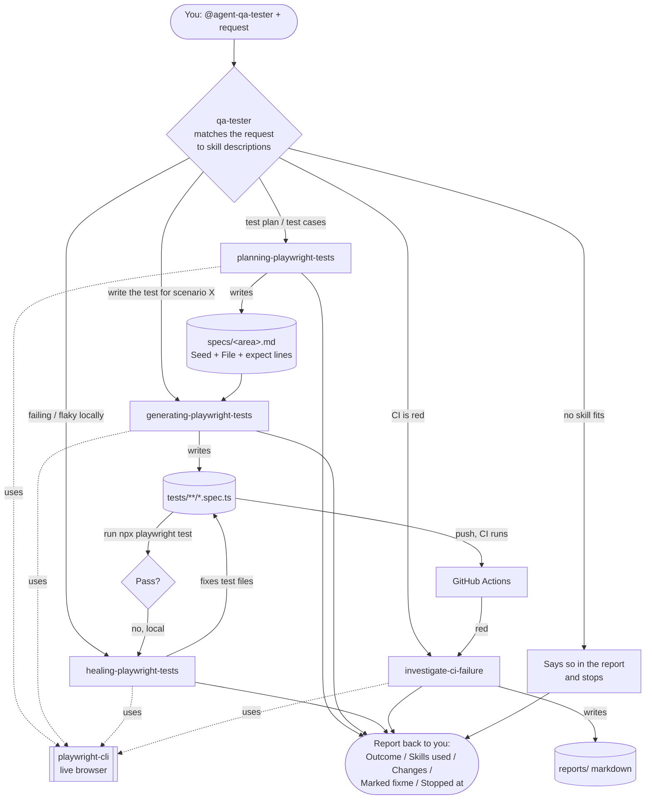

# The QA Tester Super Agent: One Agent, Many Skills

How we built one QA tester agent that picks the right skill for each job, and
what we learned about writing skills that actually work. This follows on from
[09-skill-frontmatter.md](09-skill-frontmatter.md) and
[10-skill-claude-skills-best-practices.md](10-skill-claude-skills-best-practices.md).

Sources:

- [writing-skills](https://github.com/obra/superpowers/blob/main/skills/writing-skills/SKILL.md)
  (obra/superpowers), the method we used to write and test every skill
- [Subagents](https://code.claude.com/docs/en/sub-agents) and
  [Skills](https://code.claude.com/docs/en/skills) (Claude Code docs), for how
  a called agent starts up and finds skills
- Our own design, plan and test logs:
  `docs/superpowers/specs/2026-11-10-qa-tester-super-agent-design.md`,
  `docs/superpowers/plans/2026-11-10-qa-tester-super-agent.md`,
  `docs/superpowers/skill-tests/`

## Why

There are two ways to set up agents:

- **Many agents:** one agent per job (planner, generator, healer...).
- **Super agent:** one agent with a toolbox of skills.

We went with the **super agent**. The agent file stays small: who the tester
is, how it works and what it must never do. Everything it can *do* lives in
skills. To add a capability, add a skill. You don't touch the agent.

You call it from your normal session when there's QA work:

```
@agent-qa-tester write a test plan for the Swag Labs inventory page
```

## How a called agent finds its skills

We checked the Claude Code docs. **You don't tell the agent where the skills
are.** Not in `CLAUDE.md`, and not in the agent file.

1. You call it (`@agent-qa-tester ...` or "use the qa-tester to ...").
2. It starts with a **clean slate**: it doesn't see your conversation, so the
   hand-off message must stand on its own.
3. It loads: its own file as its instructions, the task message, all
   `CLAUDE.md` files and your rules in `~/.claude/rules/`, plus a git status
   snapshot.
4. It sees the **name and description of every skill** in `.claude/skills/`.
   A skill's full `SKILL.md` loads only when the agent picks it.
5. It does the work and reports back.

So **the `description` is everything.** It's the only thing the agent reads
when choosing a skill. We left out the agent's `skills:` list on purpose:
listing skills there preloads them every time, and you'd have to edit the
agent whenever you add a skill.

## The skills and how they fit together

| Skill | Use it when | What it produces |
|-------|-------------|------------------|
| `planning-playwright-tests` | You want a test plan or test cases for a page or flow | A plan in `specs/<area>.md`, built from the **live** site |
| `generating-playwright-tests` | You want a plan scenario turned into test code | One `.spec.ts` per scenario, checked live, run once honestly |
| `healing-playwright-tests` | Tests fail, time out or are flaky **locally** | Fixes in test files only. Shared-code fixes are proposed, not made |
| `investigate-ci-failure` | Tests failed in **GitHub Actions / CI** | A markdown report explaining why. It never changes code |
| `playwright-cli` | Something needs a live browser (open, click, snapshot, find a locator) | The browser tool the other skills use |



How to read it:

- The **solid arrows** are the normal QA cycle. You plan, then generate the
  tests from the plan, then run them. Local failures go to healing; CI
  failures go to the investigator.
- **Planning always comes first.** The generator's step 0 requires the
  scenario to be in a plan in `specs/`. If it isn't, even when you gave the
  steps yourself, it loads the planner first and then writes the test from
  that plan. The plan file is the hand-off between them. (The framework
  skills added more links, such as generating following the framework map;
  see [14-skill-test-framework-skills.md](14-skill-test-framework-skills.md).)
- The **dotted arrows** show that every Playwright skill drives the browser
  through `playwright-cli`. Nothing uses the `playwright-test` MCP server.
- **Every path ends in the same report.** Anything the tester wasn't allowed
  to do shows up under "Stopped at", with the exact change it would make.

## The tester's boundaries

The tester **stops and reports** instead of doing any of these:

- **Git:** `git add`, commit, push, branches, PRs.
- **CI files:** editing anything under `.github/`.
- **Tests:** deleting a test. `test.fixme()` is allowed, and it gets listed
  in the report.
- **Framework:** changing `playwright.config.ts`, `package.json`, `.mcp.json`,
  anything in `.claude/`, shared helpers, fixtures or page objects, or an
  existing seed file.

Your own rules (`CLAUDE.md`, `~/.claude/rules/`) always come first. These are
written instructions, not hard blocks, so you can still tell the tester to do
one of them.

## The tester's memory (its knowledge base)

The tester learns over time through Claude Code's built-in **agent memory**.
(More detail, including what happens with several apps, in
[12-agent-memory.md](12-agent-memory.md).) One line in its frontmatter turns
it on:

```yaml
memory: project
```

| Scope | Folder | Shared? |
|-------|--------|---------|
| `project` (what we use) | `.claude/agent-memory/qa-tester/` | Yes, committed to git |
| `local` | `.claude/agent-memory-local/qa-tester/` | No, this machine only |
| `user` | `~/.claude/agent-memory/qa-tester/` | Across all your projects |

How it works:

- **At startup** the tester automatically gets the first 200 lines (or 25KB)
  of `MEMORY.md`, plus instructions for reading and writing the folder. It
  needs auto memory switched on.
- **`MEMORY.md` is only an index:** one line per note, each pointing to a
  topic file.
- **Its agent file tells it when to use memory:** check it before starting,
  and save what it learned before reporting.

| Topic file | What goes in it |
|------------|-----------------|
| `app-knowledge.md` | Real locators, page quirks, bugs found |
| `failure-patterns.md` | Failures and flaky tests, and their real cause |
| `environment.md` | Machine, repo and tool gotchas |
| `ci.md` | Patterns from CI investigations |
| `decisions.md` | What you decided or prefer, and why |

We seeded it with facts confirmed while building: the login locator, the
empty-cart checkout bug, the parallel-run clash, and your git rule.

Two things to watch:

- **The boundaries had to allow it.** The tester may not edit anything in
  `.claude/`, so its memory folder is the one exception.
- **Memory is notes, not rules.** Anything it must always obey goes in
  `CLAUDE.md` or `~/.claude/rules/`. Because memory is committed, every
  change shows up in `git status`. Review it like code before you commit.

Three places hold knowledge, each with its own job:

- `CLAUDE.md` and rules: what **you** tell the agent.
- Agent memory: what the **agent** learns.
- `lessons learned/`: what you write for **yourself**.

## Writing good skills: what we learned

We followed superpowers'
[writing-skills](https://github.com/obra/superpowers/blob/main/skills/writing-skills/SKILL.md).
Its big idea is that **writing a skill is test-driven development for
instructions.**

### 1. Test first: watch it fail without the skill

> "If you didn't watch an agent fail without the skill, you don't know if
> the skill teaches the right thing."

For each skill:

1. **RED.** A fresh agent does a real task *without* the skill. Write down
   exactly what it gets wrong, in its own words.
2. **GREEN.** Write the *smallest* skill that fixes those failures. Run the
   same task again *with* the skill.
3. **REFACTOR.** Fix any new gaps and run it again.

We didn't start the next skill until the current one passed.

### 2. The description says *when*, never *how*

- Start with **"Use when..."**, write in the third person, and stay under
  about 500 characters.
- Name the **situations and keywords** that should trigger it ("failing
  test", "Timeout exceeded", "test plan").
- **Never summarise the skill's steps.** Agents that see the steps in the
  description follow the description and skip the skill body.
- Say **when not to use it** if it's easily confused with another skill
  ("Not for tests that fail when run locally").

### 3. Keep the body short and shaped

- Under about 500 words: overview, when to use, steps, a quick reference,
  one good example, and common mistakes.
- **Point to other skills by name** ("REQUIRED: the playwright-cli skill")
  instead of copying their content.
- When the output has a required shape (a plan format, a report format),
  **show the shape**. Don't just list don'ts.
- For rules agents talk themselves out of, add a **"Thought → Reality"
  table** built from what agents actually said in testing.

### 4. What the tests caught

Every RED run found something we'd never have guessed:

| Skill | Without the skill | With the skill |
|-------|-------------------|----------------|
| Descriptions | "work with Playwright tests" pulled test fixing and planning into `playwright-cli`: 25/30 right | 30/30, and later 35/35 with all 5 skills |
| Planning | Wrote the plan **from memory** and never opened the site | Explored the live site, used our format, and **found a likely bug** (checkout works with an empty cart) |
| Generating | No live check, no step comments, skipped a missing seed, **changed flags until a failed test went green** | All fixed. One honest run with the normal settings |
| Healing | **Edited a shared helper** | Fixed only the test file and proposed the helper change |
| Tester boundaries | 2/2 runs **edited `playwright.config.ts` on a guess** | 8/8 runs held every boundary |

### 5. More from the framework skills (2026-11-12)

Building three more skills
([14-skill-test-framework-skills.md](14-skill-test-framework-skills.md)) added these:

- **Check yourself, never trust the report.** Agents said "tests pass" or
  "saved nothing", so we checked: grep the specs for raw locators, hash the
  test files before and after, compare the workflow file with a saved copy,
  re-run the tests.
- **A RED run can pass.** The generating RED run had no failure. Log it as
  "no failure seen" and only change what still needs changing (here, an
  example that contradicted the new framework). Don't invent a failure to
  justify an edit.
- **Every rule has a loophole the agent will find.** "Never the value" →
  copied a "public demo" password. "Read-only" → called the Checkout button a
  write. Close each loophole with the exact case, in the agent's words.
- **Skills calling skills change behaviour.** Site mapping covered the whole
  site on its own, but only one area when planning called it. Test a skill
  both on its own and from the skill that calls it.
- **Write the rule at the right level.** Planning's partial map looked like
  a planning bug; the fix belonged in the mapping skill.
- **When things change, old boundaries silently block new work.** The old
  agent text said "no `playwright.config.ts`", so the new build skill ran
  half-way. Re-test the agent whenever a skill needs something it used to
  forbid.
- **One canonical template, referenced by name.** The framework map layout
  lives in one file in the build skill; the mapping skill points to it, so
  both write the same shape.
- **System failures aren't skill failures.** A run stopped by rate limits or
  an API safeguard says nothing about the skill. Log it as "not observed"
  rather than pass or fail, and say what's left unproven.
- **Run independent scenarios in parallel, in separate folders.** Eight agent
  situations ran at once safely because each had its own scratch repo (and
  its own `test-results/`).

The healing row above changed too: healing now **fixes** a shared page object
and re-runs every spec that uses it, because the agent is allowed to own the
framework.

## Things worth knowing (the surprises)

- **Your global rules reach called agents.** `~/.claude/rules/git-commits.md`
  stopped every commit and push, even when the request said "push it". It
  beats anything in a hand-off message, which is why we wrote "your rules
  come first" into the tester.
- **Your memory folder does *not* reach called agents.** Anything they must
  follow goes in their agent file or in `CLAUDE.md` / rules.
- **Called agents can't ask you questions mid-task.** "Ask first" has to
  mean "stop and report".
- **New skills aren't picked up straight away.** Skill folders created in a
  running session showed up only later, and a new agent needs a restart of
  Claude Code. While building, we pasted the skill text into the test
  agent's prompt to test the wording.
- **Don't run several `npx playwright test` at once in one folder.** They
  share `test-results/` and wipe each other's files, which shows up as odd
  `ENOENT` trace errors.
- **Test risky behaviour in a throwaway copy.** For the "push it" tests we
  cloned the repo into the scratchpad with the push URL disabled, so a
  misbehaving agent couldn't reach the real repo.
- **Testing costs tokens, so spend it where it matters.** Every RED run found
  something, but repeating tests on boundaries that never broke added little.
  Scale the number of runs to the risk.
- **Small leftover:** some runs checked the page with a throwaway Node script
  when they should have used `playwright-cli`. The skills could say that more
  firmly.

## Where things live

```
.claude/
  agent-memory/
    qa-tester/                       the tester's knowledge base (MEMORY.md + topic files)
  agents/
    qa-tester.md                     the super agent
    playwright-test-*.md             old agents, kept and unchanged
  skills/
    planning-playwright-tests/       new
    generating-playwright-tests/     new
    healing-playwright-tests/        new
    playwright-cli/                  description rewritten
    investigate-ci-failure/          description rewritten
docs/superpowers/
  specs/2026-11-10-qa-tester-super-agent-design.md
  plans/2026-11-10-qa-tester-super-agent.md
  skill-tests/                       RED/GREEN log for every skill
```
