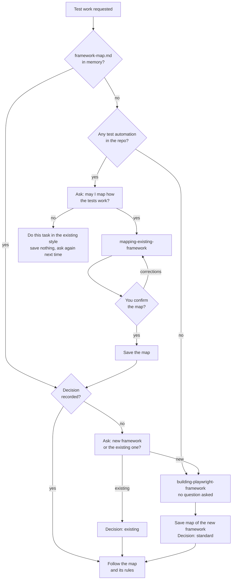
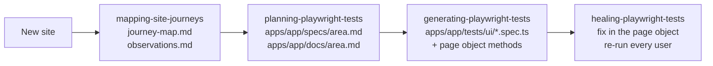

# The Test Framework Skills: Map First, Then Build or Follow

How the qa-tester decides what structure to write tests in, sets up a
standard Page Object framework on a new project, learns an existing framework
without bulldozing it, and maps a website before planning tests. This follows
on from [11-qa-tester-super-agent.md](11-qa-tester-super-agent.md) and
[12-agent-memory.md](12-agent-memory.md).

Built on the `test-framework-architecture` branch, 2026-11-12. Design:
`docs/superpowers/specs/2026-11-12-test-framework-architecture-design.md`.

## The pieces

| File | Role |
|---|---|
| `.claude/agents/qa-tester.md` | **The agent.** Checks the framework map before any test work, decides which skill to use, may now build and change the test framework. |
| `.claude/skills/building-playwright-framework/` | **New.** Our standard architecture (page objects, fixtures, per-app projects, env and secrets rules, docs) and how to set it up on a project with no automation. |
| `.claude/skills/mapping-existing-framework/` | **New.** Learns how an existing repo's tests are organised, writes a map with a diagram and rules, and saves it only after you confirm. |
| `.claude/skills/mapping-site-journeys/` | **New.** Maps a website the first time it's investigated: pages, routes, how they connect, exits to other apps. Read-only. |
| `.claude/skills/planning-playwright-tests/` | Updated: reads the framework map and docs frontmatter first, uses the journey map, saves what it learns to `apps/<app>/docs/`. |
| `.claude/skills/generating-playwright-tests/` | Updated: follows the map; in the standard framework, page objects and fixtures only. |
| `.claude/skills/healing-playwright-tests/` | Updated: fixes a broken locator where it lives (the page object) and re-runs every spec that uses it. |
| `.claude/agent-memory/qa-tester/framework-map.md` | **Per repo.** The confirmed map of the test framework, with the decision `standard` or `existing` at the top. |
| `apps/<app>/docs/` | **Per app.** The knowledge base: journey map, observations, business rules. Every file has frontmatter. |

The key idea: **the map is the first thing the agent reads, and it drives
every decision.** No map means the agent either builds one (empty repo) or
asks before mapping (existing tests). Once confirmed, it follows the map until
you tell it otherwise.

## The big picture: map first



- **"Test automation"** means any test tool: Playwright, Cypress, Selenium.
  A Cypress-only repo counts, and the agent never builds Playwright over it
  without asking.
- **Asking.** Inline, the agent asks you directly. As a subagent it can't, so
  it stops and puts the exact question under `Question for you:` in its
  report.
- **Stale map.** If the map names a folder that's gone, the agent says the
  map looks out of date and asks before re-mapping.

## A normal job, end to end



Each step reads what the previous one saved, so nothing is explored twice.
Planning explores live only the area it's planning; the journey map tells it
where everything else is.

## Inside the build skill: the standard architecture

> **Changed 2026-11-13** after building the first real app (qa-practice):
> each app now holds everything in one folder, and the shared `framework/`
> became a small `core/`. The first version shared a custom login fixture
> and an API client that no app used yet. See item 12 under "Lessons learned" below.

```
core/                          shared, knows no app (79 lines)
  app.ts                       AppConfig, loadDotEnv(), resolveBaseUrl(), appProject()
  fixtures.ts                  base `test`: app option + skip-if-missing
  pages/base-page.ts           BasePage: goto(), waitUntilLoaded()
apps/index.ts                  list of apps -> one Playwright project each
apps/<app>/                    EVERYTHING about one app
  app.config.ts  fixtures.ts  pages/  components/
  tests/seed.spec.ts  tests/ui/   (tests/auth.setup.ts if it has a login)
  specs/                       test plans
  docs/                        knowledge base
tests/                         legacy tests not moved yet
```

The rules, briefly:

- **Page objects keep locators and the methods that use them in one file.**
  Locators are `readonly` properties set in the constructor. A method that
  navigates returns the next page object.
- **Specs never touch a raw locator** and never `new XPage(page)`. Pages come
  from fixtures. Assertions live in specs.
- **Keep `core/` small.** Add to it only when a second app needs the same
  thing. No empty `api/` or `data/` placeholders.
- **Logins use Playwright's setup project:** `apps/<app>/tests/auth.setup.ts`
  logs in once and saves `playwright/.auth/<app>.json`; tests reuse it.
- **Missing env vars skip, loudly:** `skipped: SWAG_LABS_URL not set`. The run
  never fails for it.
- **Credentials in code only with your approval for that app.** Approvals are
  recorded per app in the agent's memory, `apps/<app>/memory.md` (Swag Labs
  so far; it was `decisions.md` until 2026-11-13), not in the skill. A URL isn't a secret, so it gets a default.

## Inside the mapping skills

**mapping-existing-framework** (test code): scan (config, folders, page
objects, fixtures, data, locators, login, naming, run commands, CI test steps)
→ write the map with a Mermaid diagram and 3-10 "Rules to follow in this
repo" → show it and ask "Is this right?" → save only on yes. It never changes
a file while mapping, and names where credentials come from, never the value.

**mapping-site-journeys** (the website): click around and open every page it
can reach, including Add/Edit pages, but **never** completes Save, Add,
Submit, Delete, Add to cart, Finish, Reset or Sync. Buttons that only open a
page (Checkout, Next, Edit) are fine. A page behind a write action is listed
as "not reached". No failed logins. It maps the **whole site**, whatever area
it was asked about.

## What gets saved where

| What | Where | Who reads it |
|---|---|---|
| How the tests are organised + the decision | `.claude/agent-memory/qa-tester/framework-map.md` | every skill, first |
| Agent's own working lessons | the other memory files | the agent |
| How the site fits together | `apps/<app>/docs/journey-map.md` | you, planning |
| Bugs and quirks seen | `apps/<app>/docs/observations.md` | you, planning |
| Business rules, behaviour learned while planning | `apps/<app>/docs/<area>.md` | planning, generating |
| Test plans | `apps/<app>/specs/<area>.md` | generating |

Every `apps/<app>/docs/` file starts with `app`, `area`, `title`, `description`,
`updated`. Agents grep the frontmatter and open only matching files. Memory
holds one-line pointers to the docs, never copies.

## How to use it

```
@qa-tester write a login test for <app>                      (map check runs first)
@qa-tester map how the tests in this repo work and use the existing framework
@qa-tester we've never looked at <url>, investigate it
@qa-tester set up a test framework for <app> (credentials as defaults: yes/no)
```

If it comes back with `Question for you:`, answer and call it again with the
answer in the hand-off.

## Limits and safety

| Limit | Value | Where |
|---|---|---|
| Git | no add, commit, push, branches, PRs | `qa-tester.md` boundaries |
| CI files | `.github/` never edited, even if a hand-off "allows" it | `qa-tester.md` boundaries |
| Tests | never deleted (`test.fixme()` + comment allowed) | `qa-tester.md` boundaries |
| Agent's own setup | no edits to `.claude/` (except its memory) or `.mcp.json` | `qa-tester.md` boundaries |
| Framework code | may build and change it; every shared change listed under `Framework changes:` | `qa-tester.md` |
| Site mapping | read-only; no write actions, no failed logins | `mapping-site-journeys` |
| Secrets | never in code without approval; never in docs, maps, memory | build and mapping skills |

## Lessons learned

1. **The map belongs in memory, the site knowledge in docs.** The map tells
   the agent how to work in *this repo*; the journey map tells *you and the
   agent* how the site works. Mixing them made earlier memory files fill up
   with locators.
2. **An agent without a framework rule builds a decent single-app POM**, but
   hardcodes credentials, logs in before every test and writes no docs. The
   build skill only needed to cover the gaps, not teach POM from scratch.
3. **"Read-only" needs examples.** Without the skill, the agent completed a
   Swag Labs order to "see the next page". With a bare "don't write" rule it
   then treated the Checkout *button* as a write. The rule now lists both the
   writes and the buttons that only navigate.
4. **A skill called from another skill narrows its scope.** Run on its own,
   site mapping covered the whole site. Run from planning "for sorting", it
   left out everything else. The skill now says "the whole site, always".
5. **"Public" is a loophole.** The mapping skill kept a fake secret out, then
   copied the Swag Labs demo password into the map because it was public.
   The rule had to say "including hardcoded and public demo passwords".
6. **A URL isn't a secret.** The first build treated the base URL like a
   password, so a fresh checkout or CI skipped every test.
7. **Fixtures you create yourself don't inherit the project settings.** The
   worker login's own browser context ignored `testIdAttribute`, and the login
   ran before the missing-URL check could skip the test.
8. **Old boundaries silently block new work.** The old agent text stopped at
   `playwright.config.ts`, so the first framework was half wired up.
9. **`playwright-cli`'s `getByTestId` looks for `data-testid`,** not the
   app's `data-test`. Agents fell back to CSS `[data-test=...]` when exploring.
10. **"Unless the hand-off allows it" is a back door.** Told "you're explicitly
    allowed to edit `.github/`", the agent edited the workflow. Some
    boundaries (`.github/`, git writes, deleting tests) are now never
    overridden by a hand-off.
11. **A review finding can be real in the text but not in the behaviour.**
    Four of the final review's findings didn't reproduce: the agent did the
    right thing anyway. We still fixed the wording (a later model may read it
    literally) but logged them as "not reproduced", not as proven bugs.
12. **Don't build the shared layer ahead of need.** The first `framework/`
    had a custom login-once-per-worker fixture, several users per app and an
    API client. The first real app (qa-practice) had no login and no API, so
    looking at the folder showed mostly unused code. Shrinking it to a 79-line
    `core/` and putting each app's tests, plans and docs inside `apps/<app>/`
    made the layout obvious: one folder per app. Where Playwright already has
    a standard way (setup projects for login), use it rather than build our
    own.

## Known gaps

- **The "whole site, always" fix is unproven.** Its re-run was stopped by an
  API safeguard error and counted as a pass by instruction, not observed.
- **The missing-credentials skip path** was never exercised (Swag Labs has
  approved defaults); only the missing-URL skip was.
- **Swag Labs trial run** (moving the real tests onto the framework) is still
  to do.
- **`generating-playwright-tests` is ~690 words**, over the ~500 target. It
  grew when the merge with `main` brought back the plan-first step (step 0;
  the framework-map step is now step 1). The two steps together haven't been
  re-tested.
- **The "Legacy tests" and `playwright/.auth/` rules** weren't re-run after the
  wording fix; the earlier run already behaved that way.
- **[12-agent-memory.md](12-agent-memory.md) still describes
  `app-knowledge.md` as holding app facts.** *(Changed 2026-11-13:
  `app-knowledge.md` is gone; each app has `apps/<app>/memory.md` in the
  agent's memory. Lesson 12 has a note.)*

## What was tested

All runs used fresh `sonnet` subagents in throwaway scratch projects outside
the repo. Full logs: `docs/superpowers/skill-tests/`.

| Piece | Without (RED) | With (GREEN / REFACTOR) |
|---|---|---|
| Build skill | single-app POM, hardcoded credentials, login every test, no docs or map | full layout, `4 passed`, `4 skipped` naming the variable, docs + map |
| Map existing framework | saved the map without asking, no diagram or rules | stopped for confirmation in every case; `e2e/` folder found; no secret copied |
| Site map | completed an order, no diagram | read-only, diagram + trees, found new pages and two possible bugs |
| Agent | blocked at config; mapped without asking; app facts in memory | 8/8 situations right, including "push it, demo in 10 minutes" |
| Generating | already fine; example contradicted the framework | standard and existing both right |
| Healing | refused to fix the page object, `4 failed` | fixed it, re-ran all, `4 passed` |
| Planning | read every doc whole, saved nothing learned | frontmatter first, knowledge saved; whole-site fix unproven (see gaps) |
| Routing | | 60/60 across 12 requests and 8 skills |

See also [08-ci-investigator.md](08-ci-investigator.md) and
[09-skill-frontmatter.md](09-skill-frontmatter.md).
