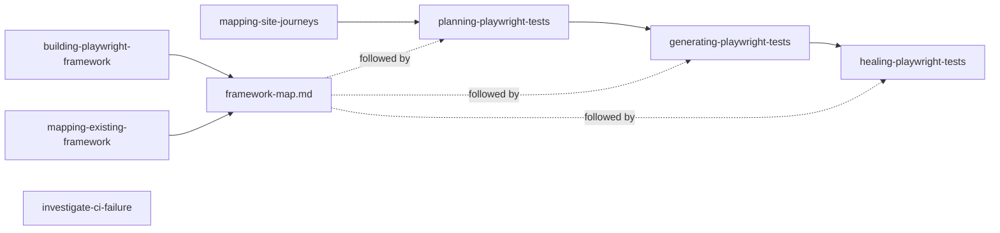

# Skill Overview

A one-page guide to the 8 skills in `.claude/skills/`. The `qa-tester` agent
picks the right skill from your request, so you rarely name one yourself.

For the details, see [11-qa-tester-super-agent.md](11-qa-tester-super-agent.md)
(the QA skills), [14-skill-test-framework-skills.md](14-skill-test-framework-skills.md)
(the framework and mapping skills) and [08-ci-investigator.md](08-ci-investigator.md)
(the CI investigator).

## Which skill do I need?

| You want to... | Skill |
|---|---|
| Start testing a repo that has no tests | `building-playwright-framework` |
| Work in a repo that already has tests | `mapping-existing-framework` (first time only) |
| Look at a website for the first time | `mapping-site-journeys` |
| Decide what to test | `planning-playwright-tests` |
| Turn a plan or steps into test code | `generating-playwright-tests` |
| Fix tests that fail on your machine | `healing-playwright-tests` |
| Find out why tests failed in CI | `investigate-ci-failure` |
| Click around a page, take a screenshot, find a locator | `playwright-cli` |

## The skills

### Set up and learn

**`building-playwright-framework`**: sets up a new Playwright framework:
a shared `framework/`, one `apps/<app>/` per app, page objects and fixtures.
Specs never use raw locators. Saves a `framework-map.md` in the agent's
memory.

**`mapping-existing-framework`**: learns how an existing repo's tests are
organised and writes it down as `framework-map.md`. It saves only after you
confirm, and every later task follows that map.

**`mapping-site-journeys`**: explores a new site and writes
`docs/apps/<app>/journey-map.md`: which pages exist, how they connect, and
where you leave for another app. Read-only: it looks at everything and
changes nothing.

### Write and fix tests

**`planning-playwright-tests`**: writes a test plan to `specs/<app>/<area>.md`.
Every step comes from the live app, never from memory. It maps the site
first if there's no journey map.

**`generating-playwright-tests`**: turns a scenario from a plan into a
`.spec.ts` file. It plans first if the scenario isn't in a plan yet, follows
the framework map, walks each step live, then runs the test.

**`healing-playwright-tests`**: fixes local failures. It finds the real
cause, fixes it where it lives (the test or the page object), and re-runs
everything that uses what changed.

### Investigate and drive the browser

**`investigate-ci-failure`**: explains why tests failed in GitHub Actions,
without changing code. It reads the CI evidence, checks the live site and
writes `reports/ci-failure-<run-id>.md`. It also runs automatically on CI
when tests fail.

**`playwright-cli`**: drives a real browser from the command line: open,
click, type, snapshot, screenshot. All the other browser skills use it.

## How they connect

- **Map first:** planning, generating and healing all read `framework-map.md`
  before doing anything.
- **Plan first:** generating won't write a test without a plan in `specs/`.
- **One browser tool:** every skill that needs a browser uses `playwright-cli`,
  not MCP. See [02-cli-vs-mcp.md](02-cli-vs-mcp.md).
- **Local or CI?** Local failures go to healing. CI failures go to the
  investigator, which only explains and never fixes.

## Good to know

- All descriptions start with "Use when..." and list triggers only. See
  [09-skill-frontmatter.md](09-skill-frontmatter.md).
- How well each skill follows the best practices:
  [10-skill-claude-skills-best-practices.md](10-skill-claude-skills-best-practices.md).
- How each skill was tested: `docs/superpowers/skill-tests/`.
